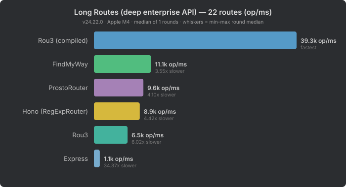

# Complex Benchmark

Benchmarks for the [Moost](https://moost.org/) stack — from the router at the foundation, through the HTTP framework, to the full decorator-driven application layer.

**Moost** is built on [Wooks](https://wooks.moost.org/), which uses [@prostojs/router](https://github.com/prostojs/router) under the hood. These benchmarks verify that every layer of the stack performs competitively against established alternatives.

## Benchmarks

| Benchmark | What it tests | Compares against |
|-----------|---------------|------------------|
| [router-benchmark](packages/router-benchmark/) | URI route matching + param extraction | find-my-way (Fastify), Rou3, Hono, Express |
| [wooks-benchmark](packages/wooks-benchmark/) | Full HTTP request handling | Fastify, Express, Hono, H3 |
| [moost-benchmark](packages/moost-benchmark/) | Decorator-based framework overhead | NestJS |

## Why These Routes?

Most framework benchmarks test "hello world" — a single `GET /` with no auth, no cookies, no body parsing. That tells you nothing about real-world performance where frameworks actually differ.

These benchmarks model a **real enterprise SaaS application** (project management API) with routes, payloads, and traffic patterns you'd see in production.

### Route Design

The API has 21 routes across three authentication layers, modeled after a typical project management tool:

| Layer | Routes | What it covers |
|-------|--------|----------------|
| **Public** | `GET /health`, `GET /static/*`, `POST /auth/login` | Health checks, static assets (with cache headers), login with Set-Cookie |
| **Header-auth** (API clients) | `GET/POST/DELETE /api/v1/users/:id`, `/projects/:id`, `/organizations/settings/billing/invoices` | Bearer token validation, param extraction, deep static paths |
| **Cookie-auth** (browser users) | `GET/PUT/DELETE /api/v1/projects/:projectId/tasks/:taskId`, `/tasks/:taskId/comments`, `/orgs/:orgId/teams/:teamId/projects/:projectId/tasks/:taskId` | Full 20-cookie jar parsing, 1-4 URL params, small and large JSON bodies |

This exercises what actually matters in production:
- **Cookie parsing** — every browser request carries ~20 cookies (session, analytics, tracking, consent, feature flags, A/B testing). Most benchmarks skip this entirely.
- **Auth guards** — real APIs reject bad credentials before processing. Frameworks that parse bodies before checking auth waste CPU on every unauthorized request.
- **Body parsing** — small JSON (single comment) and large JSON (100-item bulk operation) test different allocation patterns.
- **Route depth** — from `/health` to `/api/v1/orgs/:orgId/teams/:teamId/projects/:projectId/tasks/:taskId` (4 params, 8 segments).
- **Cache headers** — static assets and billing pages set different `Cache-Control` policies, adding response header overhead.

### Traffic Distribution

Each test case runs independently for the same duration, but the **weighted average** reflects realistic SaaS traffic proportions:

| Category | Weight | Rationale |
|----------|--------|-----------|
| Cookie-auth reads | 42% | Browser users browsing projects, viewing tasks, navigating teams — the dominant traffic in any SaaS app |
| Cookie-auth writes | 18% | Posting comments, updating task status, occasional bulk operations |
| Header-auth (API) | 16% | Mobile apps, CI/CD integrations, third-party API consumers using Bearer tokens |
| Public/static | 10% | Health checks (monitoring), static asset cache misses, documentation pages |
| Auth failures | 5% | Expired sessions and tokens — normal operational churn |
| 404s | 5% | Old bookmarks, crawler noise, mistyped URLs |
| Bot/scanner | 4% | Large POST bodies with invalid credentials — attack traffic that good frameworks reject early |

This means the headline "avg req/s" number answers: **"how fast would this framework handle a realistic mix of production traffic?"** — not "how fast can it return a string from a trivial GET".

## Results

### Router — pure route matching (22 long routes)



ProstoRouter is the fastest on deep enterprise API routes. See [router-benchmark README](packages/router-benchmark/README.md) for full results across short, long, and mixed route shapes at 22–200 routes.

### Wooks — full HTTP framework


Wooks leads on realistic SaaS traffic despite router differences compressing to just 1.5x at the framework level. See [wooks-benchmark README](packages/wooks-benchmark/README.md) for per-test breakdown.

### Moost — DI framework overhead


Moost adds just 6% overhead on top of Wooks — half of NestJS's 10–12% DI cost. See [moost-benchmark README](packages/moost-benchmark/README.md) for detailed overhead analysis.

## Running

```bash
pnpm install

# Router benchmark
pnpm bench:router         # basic benchmark (22 routes x 3 variants)
pnpm bench:router:scale   # scaling benchmark (22-200 routes x 3 variants)

# Wooks benchmark
pnpm bench:wooks

# Moost benchmark
pnpm bench:moost

# All benchmarks
pnpm bench:all
```
