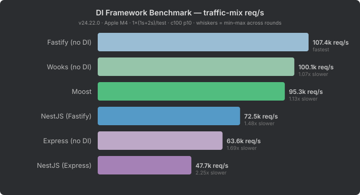

# DI Framework Benchmark

A benchmark measuring the overhead of decorator-based dependency injection frameworks on top of their underlying HTTP layer.

## Frameworks Tested

| Framework | Built on | DI system |
|-----------|----------|-----------|
| [Moost](https://moost.org/) | Wooks (→ @prostojs/router) | Compile-time decorators, lightweight DI |
| [NestJS + Fastify](https://nestjs.com/) | Fastify (→ find-my-way) | Runtime decorators, full-featured DI container |
| [NestJS + Express](https://nestjs.com/) | Express (→ path-to-regexp) | Same NestJS DI, slower HTTP base |

## What This Measures

This benchmark isolates the **cost of the DI/decorator layer** by comparing each framework against its underlying HTTP engine (tested in the [wooks benchmark](../wooks-benchmark/)):

| DI framework | Base framework | Base req/s | DI req/s | Overhead |
|--------------|---------------|-----------|---------|----------|
| Moost | Wooks | 70,332 | 66,049 | **6%** |
| NestJS (Fastify) | Fastify | 68,273 | 60,196 | **12%** |
| NestJS (Express) | Express | 47,147 | 42,359 | **10%** |

**Moost's DI costs half of what NestJS's does** — 6% overhead vs 10–12%. Both give you decorators, dependency injection, guards, and interceptors. But Moost achieves this with compile-time metadata and a lighter DI container, while NestJS uses a heavier runtime reflection system.

## Results

See [RESULTS.md](RESULTS.md) for the latest results.



| Framework | avg req/s | speed |
|-----------|----------|-------|
| Moost | 66,049 | fastest |
| NestJS (Fastify) | 60,196 | 1.1x slower |
| NestJS (Express) | 42,359 | 1.6x slower |

### Where the Overhead Goes

Not all request types are affected equally by the DI layer:

**Cookie-auth reads (42% of traffic)** — Moost loses ~6% vs Wooks (82k → 77k), NestJS loses ~8% vs Fastify (73k → 67k). Moderate impact on both.

**404 handling** — this is where NestJS hurts the most. Wooks handles 404s at ~76k, and Moost matches that at ~78k. But Fastify at ~86k drops to ~56k under NestJS — a **35% penalty** from NestJS's exception filter pipeline. Moost's 404 path has essentially zero DI overhead.

**Auth failures** — similar story. Fastify's 88k drops to 50k under NestJS (**43% penalty**), while Wooks' 69k drops to only 58k under Moost (**16%**). NestJS's guard → exception flow is expensive.

**Early auth rejection** — Moost inherits Wooks' architecture: reject bad credentials *before* parsing the body. On large-body attack traffic, Moost handles ~29k req/s. NestJS (both variants) parses the body first, dropping to ~9k. That's **3x faster** on bot/scanner traffic.

**Simple GETs** — nearly identical across all three. At ~78–82k req/s, the DI layer is invisible for basic request handling.

**Body parsing** — all three converge at ~42–51k for small bodies and ~9–10k for large bodies. `JSON.parse()` is the bottleneck, and no DI framework can optimize around it.

### The Bottom Line

Moost gives you the same decorator-driven DX as NestJS — guards, interceptors, dependency injection, class-based controllers — with roughly **half the runtime overhead**. On the most common production workload (cookie-authenticated reads), Moost on Wooks outperforms NestJS on Fastify by **14%** (77k vs 67k). On attack traffic (large body + bad auth), it's **3x faster** thanks to early rejection.

## Methodology

- Benchmark tool: [autocannon](https://github.com/mcollina/autocannon) with 100 connections, 10 pipelining
- Each test runs independently for 0.5s
- The headline "avg req/s" is a **weighted average** reflecting realistic SaaS traffic (see [root README](../../README.md#traffic-distribution))
- Each framework runs in a **separate child process** to avoid reflect-metadata conflicts between Moost and NestJS
- Quick single-framework test: `pnpm quick` (Moost only, reduced duration)

## Running

```bash
pnpm install
pnpm bench:moost
```
