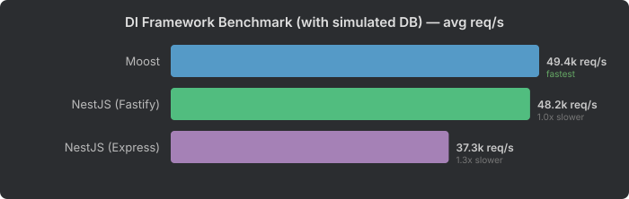

# DI Framework Benchmark

A benchmark measuring the overhead of decorator-based dependency injection frameworks on top of their underlying HTTP layer.

## Frameworks Tested

| Framework | Built on | DI system |
|-----------|----------|-----------|
| [Moost](https://moost.org/) | Wooks (→ @prostojs/router) | TypeScript decorators evaluated at runtime, design-type metadata via `emitDecoratorMetadata`; DI container `@prostojs/infact` |
| [NestJS + Fastify](https://nestjs.com/) | Fastify (→ find-my-way) | TypeScript decorators evaluated at runtime, design-type metadata via `emitDecoratorMetadata`; NestJS DI container |
| [NestJS + Express](https://nestjs.com/) | Express (→ path-to-regexp) | Same NestJS DI on the Express platform |

## What This Measures

This benchmark isolates the **cost of the DI/decorator layer** by comparing each framework with its underlying HTTP engine. The no-DI baselines (the Wooks, Fastify and Express servers from the [wooks benchmark](../wooks-benchmark/)) are measured in the same run (`--baselines`), so the comparison uses one consistent measurement.

Indicative estimate, single round on a laptop: Apple M4 MacBook Air (fanless), Node.js 24.22, 1 round of 1 s warmup + 2 s measured per test. [RESULTS.md](RESULTS.md) records the environment, versions and settings. Treat differences of a few percent as noise.

| DI framework | Base framework | Base req/s | DI req/s | DI-layer cost | Cost without the bot/scanner tests |
|--------------|---------------|-----------:|---------:|---------:|---------:|
| Moost | Wooks | 100,135 | 95,304 | **4.8%** | 4.9% |
| NestJS (Fastify) | Fastify | 107,403 | 72,506 | **32.5%** | 15.4% |
| NestJS (Express) | Express | 63,585 | 47,702 | **25.0%** | 15.1% |

req/s = traffic-mix throughput (weighted harmonic mean). Both frameworks give you decorators, dependency injection, guards and interceptors, and both evaluate their decorators at runtime using TypeScript's `emitDecoratorMetadata`.

A large part of NestJS's cost comes from the two bot/scanner tests (large POST body with bad credentials, 4% of traffic): NestJS parses the request body before its guards run, so it handles them at about 12k req/s instead of 52–77k. The last column recomputes the traffic mix without those two tests; Moost's DI-layer cost is still about a third of NestJS's.

## Results

See [RESULTS.md](RESULTS.md) for the per-test numbers and p99 latency.


| Framework | traffic-mix req/s | relative |
|-----------|----------:|-------|
| Fastify (no DI) | 107,403 | fastest |
| Wooks (no DI) | 100,135 | 1.07x slower |
| Moost | 95,304 | 1.13x slower |
| NestJS (Fastify) | 72,506 | 1.48x slower |
| Express (no DI) | 63,585 | 1.69x slower |
| NestJS (Express) | 47,702 | 2.25x slower |

### Where the Overhead Goes

Not all request types are affected equally by the DI layer:

**Cookie-auth reads (42% of traffic)** — Moost costs 0–5% vs Wooks (137–146k req/s), NestJS costs 11–14% vs Fastify (113–118k req/s). Moost is 17–24% ahead of NestJS (Fastify) on these routes.

**404 handling** — Moost handles 404s at 157–161k req/s, the same as Wooks. NestJS handles them at about 85k on Fastify (46–51% below plain Fastify) and about 51k on Express.

**Auth failures (401)** — the largest DI cost for Moost: about 100k req/s vs about 143k for Wooks (30%). NestJS loses more: about 75k vs about 180k for Fastify (58%).

**Bot/scanner traffic (large body + bad auth)** — Moost rejects before parsing the body, at 59–62k req/s (close to Wooks). NestJS parses the body first and handles these requests at about 12k on both platforms, about 5x slower than Moost.

**Static and header-auth GETs** — Moost costs 4–9% vs Wooks, NestJS 0–11% vs Fastify. Moost and NestJS (Fastify) are level on the header-auth routes; NestJS (Fastify) is 7–8% ahead on the wildcard routes and Moost 6% ahead on the short static route.

**Body parsing** — on small JSON bodies Moost costs 6–7% vs Wooks and NestJS 14–16% vs Fastify; Moost is ahead of NestJS (Fastify) on the cookie-auth POST/PUT, behind it on the header-auth POST. On the large (~25 KB) JSON body, Moost is the slowest (9,199 req/s vs about 12,300 for both NestJS platforms), as Wooks is in the wooks benchmark.

**Login (set-cookie)** — NestJS (Fastify) 98,359 vs Moost 89,285.

### The Bottom Line

Moost gives you decorator-driven controllers, guards, interceptors and dependency injection with a small DI-layer cost on top of Wooks (4.8% here). On the most common production workload (cookie-authenticated reads), Moost is 17–24% ahead of NestJS on Fastify. NestJS (Fastify) is level with or ahead of Moost on header-auth GETs, wildcard routes, login, the header-auth small POST and large bodies. The headline gap (1.31x) is widened by the bot/scanner tests, where NestJS parses the body before checking auth.

## With Simulated DB (Redis)

What happens when handlers do real work? The DB mode adds a Redis GET/SET/DEL call to every authenticated handler — each request makes a real network round-trip to a local Redis server. (Single round, 1 s warmup + 1 s measured per test; no no-DI baselines in this run.)

See [RESULTS-DB.md](RESULTS-DB.md) for the full breakdown.



| Framework | traffic-mix req/s | relative |
|-----------|----------:|-------|
| Moost | 68,346 | fastest |
| NestJS (Fastify) | 59,632 | 1.15x slower |
| NestJS (Express) | 42,168 | 1.62x slower |

### The Gap Narrows

Without DB calls Moost is 1.31x ahead of NestJS (Fastify); with one Redis call per authenticated request it is 1.15x ahead. That remaining lead comes from the bot/scanner tests: without them NestJS (Fastify) is slightly ahead (72,117 vs 68,981 req/s). Per category, with the DB call:

- **Cookie-auth reads:** Moost and NestJS (Fastify) are level, or Moost slightly ahead (80–87k req/s).
- **Header-auth routes:** NestJS (Fastify) is 24–31% ahead of Moost.
- **Static and wildcard routes, login:** NestJS (Fastify) is 4–11% ahead.
- **404s:** Moost is about 1.9x faster (157–164k vs 84–85k).
- **Bot/scanner:** Moost is about 4.8x faster (56k vs 12k), because NestJS parses the body first.

The more real work each request does — database queries, cache lookups, business logic, external API calls — the smaller the share of time spent in the framework and its DI layer. Measure your own workload before choosing a DI framework for speed.

## Methodology

Same harness and workload as the [wooks benchmark](../wooks-benchmark/README.md#methodology) (shared code in `packages/bench-utils`):

- The TypeScript servers are **compiled ahead of time** (`pnpm build` = `tsc` from TypeScript 7 with `experimentalDecorators` + `emitDecoratorMetadata`) into a git-ignored `dist/`; every `start`/`quick` script builds first. No loader runs at benchmark time.
- Every framework server runs in its **own child process** as plain `node <entry>` with identical flags for all servers, baselines included (`NODE_ENV=production`, logging disabled) — this also keeps Moost's and NestJS' `reflect-metadata` usage apart. The load generator (autocannon, 100 connections, pipelining 10) runs in the orchestrator process.
- Handlers are synchronous in pure mode; only `--db` mode returns a promise for the Redis round-trip.
- **Drain between runs:** after every run the orchestrator waits until the server process reports all client connections closed (abort after 5 s), instead of a fixed sleep.
- **Pre-flight equivalence check** on every server start (status, body, headers, invalid-body → 400).
- Per test (defaults): 2 s warmup + 5 s measured; 3 rounds with rotated framework order (the published results used a reduced run: 1 round, 1 s warmup + 2 s measured, 1 s measured in DB mode); median per test; runs with > 0.1% unexpected responses are flagged INVALID.
- Headline = weighted harmonic mean of per-test medians (traffic-mix throughput).
- Auth: Moost uses `defineAuthGuard` interceptors (run before argument resolution, so `@Body()` is never parsed for unauthorized requests); NestJS uses `@UseGuards` guards. NestJS registers its JSON body parser globally (platform default), so on both NestJS platforms the body is parsed *before* guards run — that is NestJS' idiomatic behaviour and is intentionally not worked around.
- One version of each HTTP engine: the root `pnpm.overrides` pins `express` and `fastify`, so NestJS' platform adapters run on exactly the same Express/Fastify versions as the no-DI baselines (NestJS otherwise bundles its own, slightly older copies).
- Body validation: the same minimal "body must be a JSON object" check in every handler (`BadRequestException` / `HttpError(400)`); no class-validator / schema library on either side.

`--warmup <s> --duration <s> --rounds <n> --only moost,nestjs-fastify --quick` (or `BENCH_*` env vars) are supported; `pnpm quick` is a smoke test whose numbers are not meaningful.

`--baselines` (or naming a baseline key in `--only`) additionally measures the underlying HTTP frameworks without DI (Wooks, Fastify, Express — the servers from `wooks-benchmark`, started the same way) in the same run, so the DI-layer cost table above is computed from one consistent measurement (~50 min instead of ~25).

## Running

```bash
pnpm install
pnpm --filter moost-benchmark build   # compile src/ → dist/ (the start/quick scripts do this automatically)
pnpm bench:moost        # pure framework overhead (~25 min)
pnpm bench:moost:db     # with simulated Redis DB calls (requires Redis on 127.0.0.1:6379; ~25 min)
pnpm --filter moost-benchmark quick   # smoke test (~2 min, numbers not meaningful)
```
