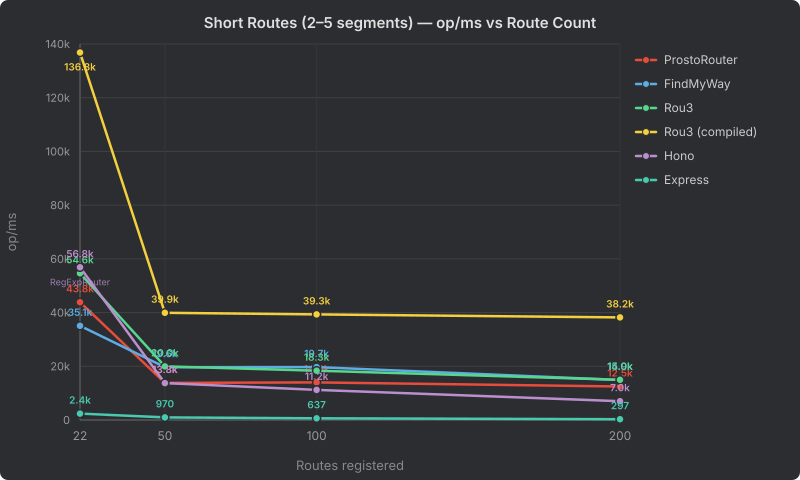
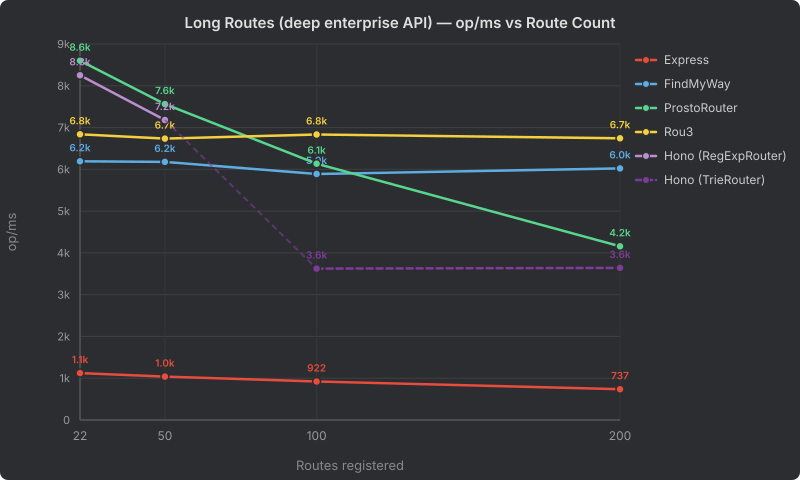
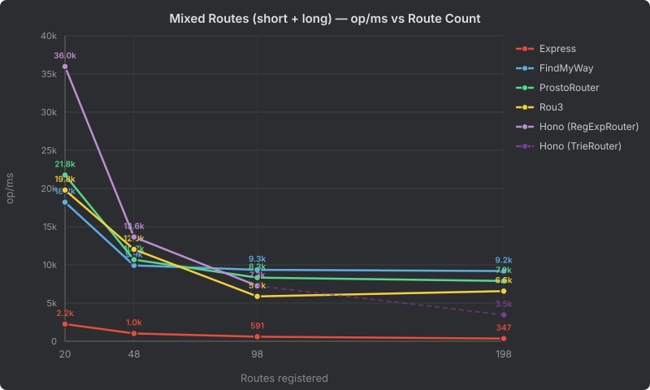

# Router Scaling Benchmark

Lookup throughput (route match + param extraction, op/ms) as the number of registered routes grows. All routers are verified to return identical matches/params before measuring. Generated 2026-10-19T11:52:46.847Z.

---

## Short Routes (2–5 segments)

Shallow paths like `/users/:id`, `/posts/:id/comments`.

| Router | 22 routes | 50 routes | 100 routes | 200 routes | first → last |
| --- | ---: | ---: | ---: | ---: | ---: |
| ProstoRouter | 43,846 | 13,815 | 14,018 | 12,457 | 3.5x |
| FindMyWay | 35,058 | 19,641 | 19,711 | 14,889 | 2.4x |
| Rou3 | 54,610 | 19,960 | 18,345 | 14,981 | 3.6x |
| Rou3 (compiled) | 136,846 | 39,929 | 39,308 | 38,184 | 3.6x |
| Hono | 56,849 (RegExpRouter) | 13,751 (RegExpRouter) | 11,226 (RegExpRouter) | 6,990 (RegExpRouter) | 8.1x |
| Express | 2,384 | 970 | 637 | 297 | 8.0x |

---

## Long Routes (deep enterprise API)

Deep paths like `/api/v1/organizations/:orgId/workspaces/:wsId/projects/:projectId`.

| Router | 22 routes | 50 routes | 100 routes | 200 routes | first → last |
| --- | ---: | ---: | ---: | ---: | ---: |
| ProstoRouter | 8,794 | 7,739 | 6,421 | 5,167 | 1.7x |
| FindMyWay | 10,816 | 10,639 | 10,479 | 10,540 | 1.0x |
| Rou3 | 4,877 | 6,733 | 4,868 | 6,738 | 0.7x |
| Rou3 (compiled) | 37,150 | 29,886 | 30,720 | 30,924 | 1.2x |
| Hono | 8,894 (RegExpRouter) | 7,505 (RegExpRouter) | 4,505 (TrieRouter) | 4,521 (TrieRouter) | 2.0x |
| Express | 1,131 | 1,059 | 937 | 697 | 1.6x |

---

## Mixed Routes (short + long)

Half short (2–5 segments) + half long (deep enterprise API) routes.

| Router | 20 routes | 48 routes | 98 routes | 198 routes | first → last |
| --- | ---: | ---: | ---: | ---: | ---: |
| ProstoRouter | 29,220 | 11,505 | 9,366 | 9,004 | 3.2x |
| FindMyWay | 28,315 | 15,967 | 14,542 | 14,230 | 2.0x |
| Rou3 | 30,839 | 15,834 | 11,981 | 10,736 | 2.9x |
| Rou3 (compiled) | 57,038 | 41,001 | 36,674 | 36,419 | 1.6x |
| Hono | 52,955 (RegExpRouter) | 15,128 (RegExpRouter) | 7,801 (RegExpRouter) | 4,072 (TrieRouter) | 13.0x |
| Express | 2,206 | 949 | 601 | 286 | 7.7x |

---

## Environment

|  |  |
| --- | --- |
| Date | 2026-10-19T11:52:46.847Z |
| Node.js | v24.22.0 (V8 13.6.233.17-node.57) |
| OS | Darwin 27.0.0 (darwin arm64) |
| CPU | Apple M4 (10 logical cores) |
| Memory | 24 GB |

### Settings

| Setting | Value |
| --- | --- |
| Route counts (target; tables show the actual count per shape) | 22, 50, 100, 200 |
| Rounds | 1 (router order rotated each round; fresh process per router × workload × round) |
| Warmup | 500 ms per test (time-based; also calibrates batch size) |
| Samples | 5 per test per round, ~100 ms each (process.hrtime.bigint) |
| Reported value | median of per-round medians, op/ms (lookups per millisecond) |
| Node flags | --expose-gc (gc() before sampling) |

### Package versions

| Package | Version |
| --- | --- |
| @prostojs/router | 0.3.6 |
| find-my-way | 9.10.0 |
| rou3 | 1.0.0 |
| hono | 4.13.13 |
| express | 5.3.0 |

