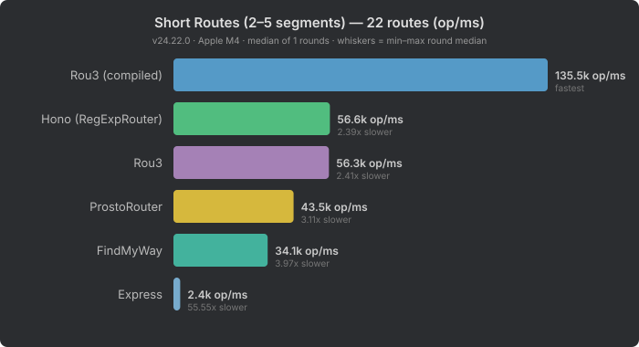
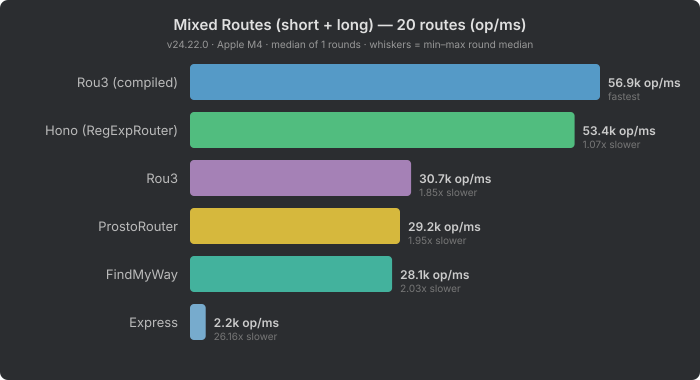

# Router Benchmark Results

Three route-shape variants tested at 22 routes each.

- **200000** operations per test
- **2** runs averaged
- Generated: 2026-02-27T00:23:12.010Z

---

## Short Routes (2–5 segments)

Shallow paths like `/users/:id`, `/posts/:id/comments`.

### Summary

| Router | avg op/ms | speed |
|--------|----------|-------|
| Hono (RegExpRouter) | 37863 | fastest |
| ProstoRouter | 36385 | 1.0x slower |
| Rou3 | 32242 | 1.2x slower |
| FindMyWay | 22374 | 1.7x slower |
| Express | 2348 | 16.1x slower |

---

## Long Routes (deep enterprise API)

Deep paths like `/api/v1/organizations/:orgId/workspaces/:wsId/projects/:projectId`.

### Summary

| Router | avg op/ms | speed |
|--------|----------|-------|
| ProstoRouter | 9020 | fastest |
| Hono (RegExpRouter) | 8250 | 1.1x slower |
| Rou3 | 7157 | 1.3x slower |
| FindMyWay | 6283 | 1.4x slower |
| Express | 1141 | 7.9x slower |

### Per-Test Results

| Test | Express op/ms | FindMyWay op/ms | ProstoRouter op/ms | Rou3 op/ms | Hono (RegExpRouter) op/ms |
|------|---------|---------|---------|---------|---------|
| Short static | 3960 | 21374 | 35449 | 61430 | 41855 |
| Long static | 2110 | 7471 | 39124 | 63406 | 42788 |
| Wildcard | 1380 | 10971 | 8977 | 8323 | 11914 |
| Single param | 1853 | 8531 | 9864 | 9098 | 7913 |
| Param + suffix | 1748 | 7015 | 8898 | 8078 | 7810 |
| Param + tasks | 1480 | 6740 | 8713 | 7938 | 7748 |
| Two params | 1192 | 5413 | 8632 | 7078 | 6594 |
| Two params + suffix | 1034 | 4624 | 7883 | 6400 | 6571 |
| Four params | 800 | 3725 | 6247 | 4534 | 5147 |
| POST with params | 761 | 5058 | 7606 | 5790 | 7651 |
| PUT with params | 853 | 6583 | 8553 | 6480 | 7810 |
| DELETE with params | 668 | 6722 | 8548 | 6508 | 7735 |
| 404 not found | 1863 | 13305 | 11066 | 10244 | 30858 |
| All together | 1141 | 6283 | 9020 | 7157 | 8250 |

---

## Mixed Routes (short + long)

Half short (2–5 segments) + half long (deep enterprise API) routes.

### Summary

| Router | avg op/ms | speed |
|--------|----------|-------|
| Hono (RegExpRouter) | 37617 | fastest |
| ProstoRouter | 21432 | 1.8x slower |
| Rou3 | 20828 | 1.8x slower |
| FindMyWay | 16786 | 2.2x slower |
| Express | 2201 | 17.1x slower |

---

