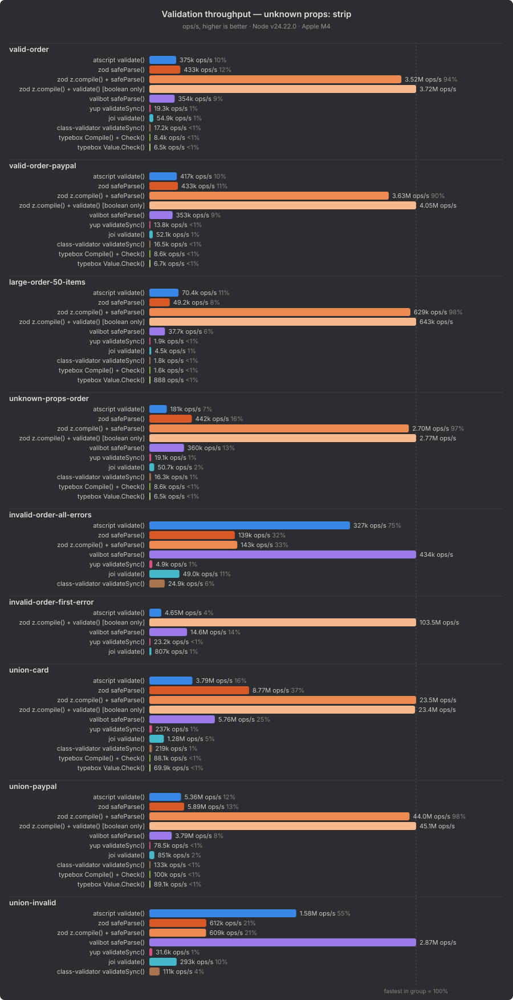
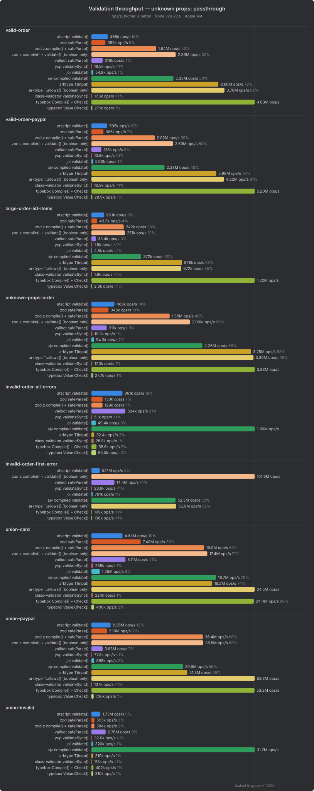
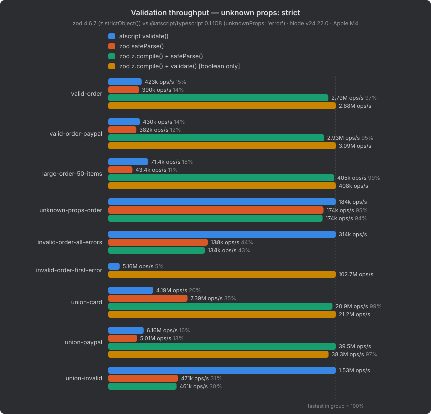

# Validator Benchmark Results

Throughput of validating the same `Order` model with an [atscript](https://atscript.dev) validator and the equivalent schema in 12 other engines of popular validation libraries. See [README.md](README.md) for what is measured and how the schemas were made equivalent.

- @atscript/typescript **0.1.109**, @atscript/core **0.1.109**, zod **4.6.7**, valibot **1.5.0**, yup **1.7.1**, joi **18.3.0**, ajv **8.20.0**, arktype **2.2.8**, class-validator **0.15.1**, class-transformer **0.5.1**, reflect-metadata **0.2.2**, typebox **1.4.2**
- 1 round(s) × 10 samples of ~40 ms per job, 1000 ms warmup, one child process per job; total 8 min
- Pre-flight: 2488 equivalence checks passed (every benchmark job, 57 edge cases × every engine × every mode it supports, unknown-props output, same-violation and first-error checks)
- Generated: 2026-10-19T20:02:07.474Z
- Chart data: [results/summary.json](results/summary.json) (`results[mode][scenario][engine]` = median ops/s)

Values are the **median ops/s** over all samples; the bracket is the p25–p75 range. "Relative" is versus the fastest engine in the same row group.

## Engines

| Engine | Call | Setup | Returns |
| --- | --- | --- | --- |
| atscript validate() | `validator.validate(input, true)` | `new Validator(type, { unknownProps, errorLimit })` | boolean (+ `validator.errors`); validates in place, no copy |
| zod safeParse() | `schema.safeParse(input)` | object JIT on (default) | `{ success, data \| error }`; `data` is a new object |
| zod z.compile() + safeParse() | `z.compile(schema).safeParse(input)` | `z.compile(schema, { strict: true })` | same as above, ahead-of-time compiled fast path |
| zod z.compile() + validate() [boolean only] | `z.compile(schema).validate(input)` | `z.compile(schema, { strict: true })` | boolean only, no output object, no error details |
| valibot safeParse() | `v.safeParser(schema, config)(input)` | `abortEarly: true` for first-error, all issues otherwise | `{ success, output \| issues }`; `output` is a new object |
| yup validateSync() | `schema.validateSync(input, options)` | `abortEarly: false` for all errors (`true` for first-error), leaves `.strict()` | the cast value (a new object only when something changed); throws `ValidationError` |
| joi validate() | `schema.prefs(options).validate(input)` | `abortEarly: false` for all errors (`true` for first-error), `convert: false` | `{ value, error }`; `value` is always a new object |
| ajv compiled validate() | `ajv.compile(jsonSchema)(input)` | `allErrors: true` for all errors (default `false` for first-error), `unicodeRegExp: false` | boolean (+ `validate.errors`); validates in place, no copy |
| arktype T(input) | `T(input)` | JIT (default) | the data, or an `ArkErrors` array |
| arktype T.allows() [boolean only] | `T.allows(input)` | JIT (default) | boolean only, no error details |
| class-validator validateSync() | `validateSync(plainToInstance(Order, input), options)` | decorated classes, class-transformer `plainToInstance` | `ValidationError[]`; the instance is a new object |
| typebox Compile() + Check() | `C.Check(input)`, then `C.Errors(input)` when invalid (first-error: `C.Parse(input)`) | `Compile(type)` (JIT); `maxErrors: Infinity`; first-error via `C.Parse()` | boolean; errors array from `Errors()`; validates (and cleans) in place |
| typebox Value.Check() | `Value.Check(T, input)`, then `Value.Errors(T, input)` when invalid | dynamic (no compile); `maxErrors: Infinity`; first-error via `Value.Parse()` | same as above, without compiling |

## Unknown props: strip

atscript `unknownProps: 'strip'` · zod `z.object()` · valibot `v.object()` · yup `stripUnknown: true` · joi `stripUnknown: true` · ajv `additionalProperties: false + removeAdditional: true` · arktype `'+': 'delete'` · class-validator `whitelist: true` · typebox `open objects + Clean() after Check()`

| Scenario | Engine | ops/s (median) | p25–p75 | ns/op | Relative |
| --- | --- | ---: | ---: | ---: | ---: |
| valid-order | zod z.compile() + validate() [boolean only] | 3,724,760 | 3,282,029–3,747,163 | 268 | fastest |
|  | zod z.compile() + safeParse() | 3,519,617 | 3,078,219–3,582,501 | 284 | 1.06x slower |
|  | zod safeParse() | 433,236 | 348,065–438,644 | 2,308 | 8.60x slower |
|  | atscript validate() | 375,049 | 374,695–376,341 | 2,666 | 9.93x slower |
|  | valibot safeParse() | 353,651 | 350,440–361,749 | 2,828 | 10.53x slower |
|  | joi validate() | 54,898 | 54,696–55,109 | 18,216 | 67.85x slower |
|  | yup validateSync() | 19,323 | 17,667–19,373 | 51,751 | 192.76x slower |
|  | class-validator validateSync() | 17,205 | 17,051–17,470 | 58,122 | 216.49x slower |
|  | typebox Compile() + Check() | 8,434 | 8,107–8,566 | 118,569 | 441.64x slower |
|  | typebox Value.Check() | 6,547 | 6,229–6,705 | 152,743 | 568.93x slower |
| valid-order-paypal | zod z.compile() + validate() [boolean only] | 4,047,537 | 3,609,424–4,089,635 | 247 | fastest |
|  | zod z.compile() + safeParse() | 3,632,478 | 3,216,503–3,704,244 | 275 | 1.11x slower |
|  | zod safeParse() | 433,064 | 341,628–435,230 | 2,309 | 9.35x slower |
|  | atscript validate() | 417,211 | 414,497–417,648 | 2,397 | 9.70x slower |
|  | valibot safeParse() | 353,073 | 342,636–353,861 | 2,832 | 11.46x slower |
|  | joi validate() | 52,125 | 51,968–52,739 | 19,185 | 77.65x slower |
|  | class-validator validateSync() | 16,461 | 16,199–16,690 | 60,749 | 245.89x slower |
|  | yup validateSync() | 13,779 | 13,751–14,109 | 72,575 | 293.75x slower |
|  | typebox Compile() + Check() | 8,620 | 8,232–8,748 | 116,009 | 469.55x slower |
|  | typebox Value.Check() | 6,748 | 6,347–6,865 | 148,183 | 599.81x slower |
| large-order-50-items | zod z.compile() + validate() [boolean only] | 643,149 | 560,190–655,383 | 1,555 | fastest |
|  | zod z.compile() + safeParse() | 629,388 | 528,278–634,998 | 1,589 | 1.02x slower |
|  | atscript validate() | 70,428 | 70,249–70,860 | 14,199 | 9.13x slower |
|  | zod safeParse() | 49,187 | 44,509–50,590 | 20,331 | 13.08x slower |
|  | valibot safeParse() | 37,695 | 36,553–37,908 | 26,528 | 17.06x slower |
|  | joi validate() | 4,529 | 4,497–4,557 | 220,818 | 142.01x slower |
|  | yup validateSync() | 1,936 | 1,739–1,962 | 516,580 | 332.21x slower |
|  | class-validator validateSync() | 1,770 | 1,730–1,842 | 564,859 | 363.36x slower |
|  | typebox Compile() + Check() | 1,599 | 1,517–1,623 | 625,215 | 402.22x slower |
|  | typebox Value.Check() | 888 | 854–910 | 1,126,172 | 724.27x slower |
| unknown-props-order | zod z.compile() + validate() [boolean only] | 2,772,667 | 2,624,604–2,948,527 | 361 | fastest |
|  | zod z.compile() + safeParse() | 2,696,672 | 2,551,390–2,796,823 | 371 | 1.03x slower |
|  | zod safeParse() | 442,130 | 352,285–447,338 | 2,262 | 6.27x slower |
|  | valibot safeParse() | 360,185 | 345,724–366,500 | 2,776 | 7.70x slower |
|  | atscript validate() | 181,246 | 180,210–181,855 | 5,517 | 15.30x slower |
|  | joi validate() | 50,708 | 50,111–50,966 | 19,721 | 54.68x slower |
|  | yup validateSync() | 19,146 | 17,446–19,380 | 52,231 | 144.82x slower |
|  | class-validator validateSync() | 16,338 | 16,033–16,465 | 61,207 | 169.71x slower |
|  | typebox Compile() + Check() | 8,625 | 8,377–8,724 | 115,943 | 321.47x slower |
|  | typebox Value.Check() | 6,464 | 6,414–6,494 | 154,692 | 428.94x slower |
| invalid-order-all-errors | valibot safeParse() | 434,193 | 404,085–435,969 | 2,303 | fastest |
|  | atscript validate() | 326,562 | 316,950–327,763 | 3,062 | 1.33x slower |
|  | zod z.compile() + safeParse() | 143,172 | 136,633–146,771 | 6,985 | 3.03x slower |
|  | zod safeParse() | 139,207 | 108,699–144,792 | 7,184 | 3.12x slower |
|  | joi validate() | 48,966 | 48,398–49,086 | 20,422 | 8.87x slower |
|  | class-validator validateSync() | 24,948 | 24,820–25,292 | 40,084 | 17.40x slower |
|  | yup validateSync() | 4,942 | 4,767–5,300 | 202,339 | 87.86x slower |
| invalid-order-first-error | zod z.compile() + validate() [boolean only] | 103,533,696 | 101,166,739–104,551,167 | 10 | fastest |
|  | valibot safeParse() | 14,624,712 | 14,035,532–14,634,677 | 68 | 7.08x slower |
|  | atscript validate() | 4,651,024 | 4,639,028–4,655,251 | 215 | 22.26x slower |
|  | joi validate() | 806,859 | 799,210–814,820 | 1,239 | 128.32x slower |
|  | yup validateSync() | 23,233 | 22,938–23,770 | 43,042 | 4456.32x slower |
| union-card | zod z.compile() + safeParse() | 23,453,830 | 23,350,041–23,465,493 | 43 | fastest |
|  | zod z.compile() + validate() [boolean only] | 23,361,976 | 23,294,088–23,385,081 | 43 | 1.00x slower |
|  | zod safeParse() | 8,769,705 | 8,752,495–8,790,577 | 114 | 2.67x slower |
|  | valibot safeParse() | 5,759,469 | 5,622,761–5,778,242 | 174 | 4.07x slower |
|  | atscript validate() | 3,788,153 | 3,734,026–3,805,471 | 264 | 6.19x slower |
|  | joi validate() | 1,279,273 | 1,275,547–1,282,489 | 782 | 18.33x slower |
|  | yup validateSync() | 236,641 | 230,561–242,564 | 4,226 | 99.11x slower |
|  | class-validator validateSync() | 219,370 | 213,560–220,142 | 4,559 | 106.91x slower |
|  | typebox Compile() + Check() | 88,106 | 80,882–91,709 | 11,350 | 266.20x slower |
|  | typebox Value.Check() | 69,871 | 65,189–70,708 | 14,312 | 335.67x slower |
| union-paypal | zod z.compile() + validate() [boolean only] | 45,106,639 | 44,995,096–45,326,814 | 22 | fastest |
|  | zod z.compile() + safeParse() | 43,996,917 | 43,802,580–44,052,708 | 23 | 1.03x slower |
|  | zod safeParse() | 5,889,737 | 5,520,988–5,949,881 | 170 | 7.66x slower |
|  | atscript validate() | 5,356,234 | 5,350,828–5,363,469 | 187 | 8.42x slower |
|  | valibot safeParse() | 3,791,221 | 3,380,428–4,010,750 | 264 | 11.90x slower |
|  | joi validate() | 850,613 | 845,359–857,113 | 1,176 | 53.03x slower |
|  | class-validator validateSync() | 132,530 | 131,959–133,788 | 7,545 | 340.35x slower |
|  | typebox Compile() + Check() | 100,268 | 90,943–103,032 | 9,973 | 449.86x slower |
|  | typebox Value.Check() | 89,123 | 86,837–89,676 | 11,221 | 506.12x slower |
|  | yup validateSync() | 78,545 | 76,826–79,780 | 12,731 | 574.28x slower |
| union-invalid | valibot safeParse() | 2,867,544 | 2,799,533–2,948,429 | 349 | fastest |
|  | atscript validate() | 1,578,764 | 1,570,486–1,586,709 | 633 | 1.82x slower |
|  | zod safeParse() | 611,982 | 556,532–616,800 | 1,634 | 4.69x slower |
|  | zod z.compile() + safeParse() | 609,466 | 543,466–615,185 | 1,641 | 4.71x slower |
|  | joi validate() | 293,283 | 288,961–297,261 | 3,410 | 9.78x slower |
|  | class-validator validateSync() | 111,118 | 110,406–111,946 | 8,999 | 25.81x slower |
|  | yup validateSync() | 31,580 | 31,436–32,003 | 31,666 | 90.80x slower |

## Unknown props: passthrough

atscript `unknownProps: 'ignore'` · zod `z.looseObject()` · valibot `v.looseObject()` · yup `default` · joi `allowUnknown: true` · ajv `open objects` · arktype `'+': 'ignore' (default)` · class-validator `default` · typebox `open objects (default)`

| Scenario | Engine | ops/s (median) | p25–p75 | ns/op | Relative |
| --- | --- | ---: | ---: | ---: | ---: |
| valid-order | typebox Compile() + Check() | 4,633,019 | 4,592,997–4,637,472 | 216 | fastest |
|  | arktype T.allows() [boolean only] | 3,775,921 | 3,750,322–3,823,564 | 265 | 1.23x slower |
|  | arktype T(input) | 3,602,102 | 3,593,751–3,604,278 | 278 | 1.29x slower |
|  | zod z.compile() + validate() [boolean only] | 2,391,635 | 2,154,997–2,412,957 | 418 | 1.94x slower |
|  | ajv compiled validate() | 2,326,338 | 2,314,466–2,339,308 | 430 | 1.99x slower |
|  | zod z.compile() + safeParse() | 1,836,148 | 1,586,950–1,870,151 | 545 | 2.52x slower |
|  | atscript validate() | 465,739 | 460,949–470,559 | 2,147 | 9.95x slower |
|  | zod safeParse() | 397,722 | 329,646–403,472 | 2,514 | 11.65x slower |
|  | valibot safeParse() | 317,934 | 306,059–320,416 | 3,145 | 14.57x slower |
|  | joi validate() | 54,848 | 54,605–55,020 | 18,232 | 84.47x slower |
|  | typebox Value.Check() | 27,054 | 26,770–27,133 | 36,964 | 171.25x slower |
|  | yup validateSync() | 19,458 | 17,653–19,577 | 51,393 | 238.10x slower |
|  | class-validator validateSync() | 17,308 | 17,208–17,665 | 57,778 | 267.68x slower |
| valid-order-paypal | typebox Compile() + Check() | 5,199,552 | 5,166,761–5,234,396 | 192 | fastest |
|  | arktype T.allows() [boolean only] | 4,217,727 | 4,200,376–4,231,014 | 237 | 1.23x slower |
|  | arktype T(input) | 3,975,095 | 3,963,399–3,976,654 | 252 | 1.31x slower |
|  | zod z.compile() + validate() [boolean only] | 2,594,367 | 2,310,602–2,616,300 | 385 | 2.00x slower |
|  | ajv compiled validate() | 2,328,330 | 2,325,640–2,340,118 | 429 | 2.23x slower |
|  | zod z.compile() + safeParse() | 2,015,681 | 1,722,349–2,019,448 | 496 | 2.58x slower |
|  | atscript validate() | 505,353 | 503,846–517,667 | 1,979 | 10.29x slower |
|  | zod safeParse() | 384,815 | 374,041–385,234 | 2,599 | 13.51x slower |
|  | valibot safeParse() | 316,037 | 299,594–318,970 | 3,164 | 16.45x slower |
|  | joi validate() | 53,000 | 52,776–53,148 | 18,868 | 98.10x slower |
|  | typebox Value.Check() | 28,926 | 28,678–28,992 | 34,571 | 179.75x slower |
|  | class-validator validateSync() | 16,900 | 16,708–17,098 | 59,170 | 307.67x slower |
|  | yup validateSync() | 13,795 | 13,549–13,974 | 72,490 | 376.92x slower |
| large-order-50-items | typebox Compile() + Check() | 1,221,992 | 1,210,630–1,235,705 | 818 | fastest |
|  | arktype T(input) | 677,872 | 676,807–678,162 | 1,475 | 1.80x slower |
|  | arktype T.allows() [boolean only] | 672,338 | 665,651–674,155 | 1,487 | 1.82x slower |
|  | ajv compiled validate() | 372,028 | 371,411–372,390 | 2,688 | 3.28x slower |
|  | zod z.compile() + validate() [boolean only] | 250,761 | 221,476–253,668 | 3,988 | 4.87x slower |
|  | zod z.compile() + safeParse() | 241,759 | 209,681–244,702 | 4,136 | 5.05x slower |
|  | atscript validate() | 95,128 | 94,179–95,760 | 10,512 | 12.85x slower |
|  | zod safeParse() | 43,269 | 39,597–44,627 | 23,111 | 28.24x slower |
|  | valibot safeParse() | 33,419 | 32,542–33,518 | 29,923 | 36.57x slower |
|  | joi validate() | 4,486 | 4,458–4,492 | 222,924 | 272.40x slower |
|  | typebox Value.Check() | 2,285 | 2,271–2,290 | 437,732 | 534.79x slower |
|  | class-validator validateSync() | 1,946 | 1,790–1,999 | 513,940 | 627.95x slower |
|  | yup validateSync() | 1,936 | 1,726–1,943 | 516,439 | 631.19x slower |
| unknown-props-order | typebox Compile() + Check() | 3,325,143 | 3,308,574–3,348,027 | 301 | fastest |
|  | arktype T.allows() [boolean only] | 3,300,945 | 3,145,727–3,365,370 | 303 | 1.01x slower |
|  | arktype T(input) | 3,249,681 | 3,180,728–3,313,132 | 308 | 1.02x slower |
|  | ajv compiled validate() | 2,259,134 | 2,237,655–2,267,220 | 443 | 1.47x slower |
|  | zod z.compile() + validate() [boolean only] | 2,004,970 | 1,821,870–2,039,756 | 499 | 1.66x slower |
|  | zod z.compile() + safeParse() | 1,592,754 | 1,349,209–1,619,889 | 628 | 2.09x slower |
|  | atscript validate() | 468,046 | 465,321–471,650 | 2,137 | 7.10x slower |
|  | zod safeParse() | 348,131 | 286,370–354,291 | 2,872 | 9.55x slower |
|  | valibot safeParse() | 311,019 | 296,871–312,033 | 3,215 | 10.69x slower |
|  | joi validate() | 54,321 | 54,004–54,643 | 18,409 | 61.21x slower |
|  | typebox Value.Check() | 27,739 | 27,541–27,951 | 36,050 | 119.87x slower |
|  | yup validateSync() | 19,301 | 17,626–19,472 | 51,811 | 172.28x slower |
|  | class-validator validateSync() | 17,312 | 17,079–17,421 | 57,762 | 192.07x slower |
| invalid-order-all-errors | ajv compiled validate() | 1,897,593 | 1,894,750–1,898,965 | 527 | fastest |
|  | valibot safeParse() | 394,022 | 357,526–398,246 | 2,538 | 4.82x slower |
|  | atscript validate() | 360,701 | 359,144–367,757 | 2,772 | 5.26x slower |
|  | zod safeParse() | 129,734 | 101,429–136,237 | 7,708 | 14.63x slower |
|  | zod z.compile() + safeParse() | 129,102 | 126,676–134,803 | 7,746 | 14.70x slower |
|  | typebox Compile() + Check() | 58,597 | 57,638–58,720 | 17,066 | 32.38x slower |
|  | typebox Value.Check() | 53,974 | 53,210–54,684 | 18,527 | 35.16x slower |
|  | joi validate() | 49,381 | 48,417–50,345 | 20,251 | 38.43x slower |
|  | arktype T(input) | 32,415 | 32,082–32,720 | 30,850 | 58.54x slower |
|  | class-validator validateSync() | 25,834 | 25,688–26,200 | 38,708 | 73.45x slower |
|  | yup validateSync() | 5,091 | 4,769–5,255 | 196,408 | 372.73x slower |
| invalid-order-first-error | zod z.compile() + validate() [boolean only] | 101,885,488 | 100,903,595–103,295,099 | 10 | fastest |
|  | arktype T.allows() [boolean only] | 52,924,536 | 52,702,615–53,299,107 | 19 | 1.93x slower |
|  | ajv compiled validate() | 52,505,799 | 52,448,439–52,637,848 | 19 | 1.94x slower |
|  | valibot safeParse() | 14,366,685 | 13,746,699–14,441,013 | 70 | 7.09x slower |
|  | atscript validate() | 5,166,955 | 5,154,480–5,170,523 | 194 | 19.72x slower |
|  | joi validate() | 760,624 | 758,468–772,233 | 1,315 | 133.95x slower |
|  | typebox Compile() + Check() | 168,945 | 165,227–177,510 | 5,919 | 603.07x slower |
|  | typebox Value.Check() | 135,602 | 132,099–137,716 | 7,375 | 751.36x slower |
|  | yup validateSync() | 23,931 | 23,167–24,193 | 41,787 | 4257.47x slower |
| union-card | arktype T.allows() [boolean only] | 24,549,247 | 24,500,025–24,741,040 | 41 | fastest |
|  | typebox Compile() + Check() | 24,412,503 | 24,392,624–24,542,187 | 41 | 1.01x slower |
|  | ajv compiled validate() | 18,724,563 | 18,391,721–18,876,054 | 53 | 1.31x slower |
|  | arktype T(input) | 18,159,428 | 18,114,678–18,226,457 | 55 | 1.35x slower |
|  | zod z.compile() + validate() [boolean only] | 17,424,917 | 17,321,822–17,454,634 | 57 | 1.41x slower |
|  | zod z.compile() + safeParse() | 16,937,344 | 16,923,424–16,953,710 | 59 | 1.45x slower |
|  | zod safeParse() | 7,402,533 | 7,395,370–7,410,593 | 135 | 3.32x slower |
|  | valibot safeParse() | 5,114,988 | 4,939,727–5,129,632 | 196 | 4.80x slower |
|  | atscript validate() | 4,675,581 | 4,657,321–4,683,622 | 214 | 5.25x slower |
|  | joi validate() | 1,254,260 | 1,118,927–1,255,690 | 797 | 19.57x slower |
|  | typebox Value.Check() | 399,819 | 397,511–400,566 | 2,501 | 61.40x slower |
|  | yup validateSync() | 238,965 | 231,958–243,799 | 4,185 | 102.73x slower |
|  | class-validator validateSync() | 224,003 | 223,332–227,560 | 4,464 | 109.59x slower |
| union-paypal | arktype T.allows() [boolean only] | 53,292,635 | 53,057,507–53,381,742 | 19 | fastest |
|  | typebox Compile() + Check() | 53,227,782 | 52,601,155–53,648,185 | 19 | 1.00x slower |
|  | zod z.compile() + validate() [boolean only] | 36,472,171 | 36,356,385–36,549,842 | 27 | 1.46x slower |
|  | zod z.compile() + safeParse() | 36,369,125 | 34,774,066–36,644,208 | 27 | 1.47x slower |
|  | arktype T(input) | 31,291,816 | 31,079,500–31,625,271 | 32 | 1.70x slower |
|  | ajv compiled validate() | 29,877,607 | 29,828,903–29,926,382 | 33 | 1.78x slower |
|  | atscript validate() | 6,255,411 | 6,236,809–6,278,690 | 160 | 8.52x slower |
|  | zod safeParse() | 5,099,578 | 4,804,731–5,165,417 | 196 | 10.45x slower |
|  | valibot safeParse() | 3,651,240 | 3,396,854–3,714,780 | 274 | 14.60x slower |
|  | joi validate() | 899,419 | 866,841–905,054 | 1,112 | 59.25x slower |
|  | typebox Value.Check() | 729,934 | 723,631–731,096 | 1,370 | 73.01x slower |
|  | class-validator validateSync() | 136,961 | 133,463–138,601 | 7,301 | 389.11x slower |
|  | yup validateSync() | 77,796 | 76,822–78,683 | 12,854 | 685.03x slower |
| union-invalid | ajv compiled validate() | 31,712,219 | 31,488,812–31,844,235 | 32 | fastest |
|  | valibot safeParse() | 2,757,403 | 2,611,033–2,797,973 | 363 | 11.50x slower |
|  | atscript validate() | 1,733,895 | 1,729,513–1,738,383 | 577 | 18.29x slower |
|  | zod safeParse() | 593,055 | 534,526–597,707 | 1,686 | 53.47x slower |
|  | zod z.compile() + safeParse() | 584,413 | 522,251–591,277 | 1,711 | 54.26x slower |
|  | typebox Compile() + Check() | 401,779 | 396,597–405,699 | 2,489 | 78.93x slower |
|  | joi validate() | 320,291 | 318,135–322,758 | 3,122 | 99.01x slower |
|  | typebox Value.Check() | 310,206 | 309,482–312,343 | 3,224 | 102.23x slower |
|  | arktype T(input) | 310,001 | 305,666–311,797 | 3,226 | 102.30x slower |
|  | class-validator validateSync() | 118,288 | 117,689–121,203 | 8,454 | 268.09x slower |
|  | yup validateSync() | 32,032 | 31,694–32,297 | 31,218 | 990.02x slower |

## Unknown props: strict

atscript `unknownProps: 'error'` · zod `z.strictObject()` · valibot `v.strictObject()` · yup `.exact()` · joi `default` · ajv `additionalProperties: false` · arktype `'+': 'reject'` · class-validator `whitelist + forbidNonWhitelisted` · typebox `additionalProperties: false`

| Scenario | Engine | ops/s (median) | p25–p75 | ns/op | Relative |
| --- | --- | ---: | ---: | ---: | ---: |
| valid-order | zod z.compile() + validate() [boolean only] | 2,916,522 | 2,558,181–2,926,681 | 343 | fastest |
|  | zod z.compile() + safeParse() | 2,794,374 | 2,406,473–2,831,161 | 358 | 1.04x slower |
|  | ajv compiled validate() | 1,731,596 | 1,700,498–1,787,250 | 578 | 1.68x slower |
|  | typebox Compile() + Check() | 1,199,014 | 1,198,371–1,205,349 | 834 | 2.43x slower |
|  | arktype T(input) | 920,494 | 919,769–924,385 | 1,086 | 3.17x slower |
|  | arktype T.allows() [boolean only] | 915,653 | 912,307–918,432 | 1,092 | 3.19x slower |
|  | atscript validate() | 408,515 | 407,957–409,242 | 2,448 | 7.14x slower |
|  | zod safeParse() | 389,196 | 313,831–398,729 | 2,569 | 7.49x slower |
|  | valibot safeParse() | 312,315 | 304,912–318,163 | 3,202 | 9.34x slower |
|  | joi validate() | 54,910 | 54,702–55,025 | 18,212 | 53.11x slower |
|  | typebox Value.Check() | 20,906 | 20,811–21,084 | 47,833 | 139.51x slower |
|  | yup validateSync() | 18,720 | 17,111–19,036 | 53,418 | 155.80x slower |
|  | class-validator validateSync() | 17,452 | 17,118–17,620 | 57,302 | 167.12x slower |
| valid-order-paypal | zod z.compile() + validate() [boolean only] | 2,989,883 | 2,705,947–3,034,899 | 334 | fastest |
|  | zod z.compile() + safeParse() | 2,934,507 | 2,564,137–2,976,054 | 341 | 1.02x slower |
|  | ajv compiled validate() | 1,784,650 | 1,776,636–1,789,174 | 560 | 1.68x slower |
|  | typebox Compile() + Check() | 1,260,637 | 1,255,716–1,280,113 | 793 | 2.37x slower |
|  | arktype T(input) | 1,011,801 | 1,005,609–1,015,048 | 988 | 2.96x slower |
|  | arktype T.allows() [boolean only] | 983,912 | 982,526–985,129 | 1,016 | 3.04x slower |
|  | atscript validate() | 418,689 | 416,665–419,748 | 2,388 | 7.14x slower |
|  | zod safeParse() | 379,544 | 369,496–380,017 | 2,635 | 7.88x slower |
|  | valibot safeParse() | 314,737 | 303,462–320,495 | 3,177 | 9.50x slower |
|  | joi validate() | 51,761 | 51,629–52,320 | 19,319 | 57.76x slower |
|  | typebox Value.Check() | 21,781 | 21,745–21,918 | 45,912 | 137.27x slower |
|  | class-validator validateSync() | 15,985 | 15,820–16,272 | 62,560 | 187.04x slower |
|  | yup validateSync() | 13,791 | 13,545–14,133 | 72,513 | 216.80x slower |
| large-order-50-items | zod z.compile() + validate() [boolean only] | 405,978 | 353,551–410,176 | 2,463 | fastest |
|  | zod z.compile() + safeParse() | 397,790 | 340,871–402,917 | 2,514 | 1.02x slower |
|  | ajv compiled validate() | 292,587 | 277,726–298,461 | 3,418 | 1.39x slower |
|  | typebox Compile() + Check() | 144,851 | 144,442–145,452 | 6,904 | 2.80x slower |
|  | arktype T.allows() [boolean only] | 101,977 | 101,211–102,284 | 9,806 | 3.98x slower |
|  | arktype T(input) | 99,465 | 99,131–99,610 | 10,054 | 4.08x slower |
|  | atscript validate() | 69,496 | 69,133–69,674 | 14,389 | 5.84x slower |
|  | zod safeParse() | 42,769 | 39,123–44,026 | 23,381 | 9.49x slower |
|  | valibot safeParse() | 34,403 | 33,596–34,471 | 29,067 | 11.80x slower |
|  | joi validate() | 4,548 | 4,495–4,558 | 219,876 | 89.27x slower |
|  | yup validateSync() | 1,855 | 1,673–1,874 | 539,057 | 218.86x slower |
|  | typebox Value.Check() | 1,799 | 1,786–1,809 | 555,760 | 225.67x slower |
|  | class-validator validateSync() | 1,783 | 1,768–1,801 | 560,905 | 227.69x slower |
| unknown-props-order | ajv compiled validate() | 1,469,757 | 1,465,301–1,490,960 | 680 | fastest |
|  | valibot safeParse() | 240,060 | 229,227–242,473 | 4,166 | 6.12x slower |
|  | atscript validate() | 193,381 | 193,252–193,701 | 5,171 | 7.60x slower |
|  | zod safeParse() | 173,737 | 135,573–180,362 | 5,756 | 8.46x slower |
|  | zod z.compile() + safeParse() | 171,355 | 159,457–172,713 | 5,836 | 8.58x slower |
|  | arktype T(input) | 41,443 | 40,389–41,556 | 24,129 | 35.46x slower |
|  | joi validate() | 32,821 | 32,142–33,468 | 30,468 | 44.78x slower |
|  | class-validator validateSync() | 15,279 | 15,104–15,376 | 65,449 | 96.19x slower |
|  | typebox Compile() + Check() | 13,331 | 13,158–13,379 | 75,012 | 110.25x slower |
|  | typebox Value.Check() | 12,840 | 12,781–12,936 | 77,880 | 114.47x slower |
|  | yup validateSync() | 5,728 | 5,411–5,933 | 174,591 | 256.59x slower |
| invalid-order-all-errors | ajv compiled validate() | 1,650,932 | 1,630,491–1,656,101 | 606 | fastest |
|  | valibot safeParse() | 390,780 | 364,567–392,970 | 2,559 | 4.22x slower |
|  | atscript validate() | 309,110 | 308,938–309,541 | 3,235 | 5.34x slower |
|  | zod z.compile() + safeParse() | 138,388 | 130,873–141,490 | 7,226 | 11.93x slower |
|  | zod safeParse() | 133,111 | 103,075–134,719 | 7,513 | 12.40x slower |
|  | joi validate() | 43,952 | 43,387–44,560 | 22,752 | 37.56x slower |
|  | typebox Compile() + Check() | 38,881 | 38,646–39,663 | 25,719 | 42.46x slower |
|  | typebox Value.Check() | 35,928 | 35,629–36,055 | 27,834 | 45.95x slower |
|  | arktype T(input) | 32,733 | 32,466–33,045 | 30,550 | 50.44x slower |
|  | class-validator validateSync() | 25,143 | 24,617–25,840 | 39,773 | 65.66x slower |
|  | yup validateSync() | 4,570 | 4,280–4,705 | 218,810 | 361.25x slower |
| invalid-order-first-error | zod z.compile() + validate() [boolean only] | 103,299,318 | 103,115,675–103,439,681 | 10 | fastest |
|  | arktype T.allows() [boolean only] | 52,127,931 | 51,919,868–52,879,347 | 19 | 1.98x slower |
|  | ajv compiled validate() | 15,247,172 | 15,022,040–15,303,720 | 66 | 6.77x slower |
|  | valibot safeParse() | 14,224,906 | 13,612,184–14,294,367 | 70 | 7.26x slower |
|  | atscript validate() | 3,696,064 | 3,690,030–3,698,506 | 271 | 27.95x slower |
|  | joi validate() | 793,593 | 778,526–807,552 | 1,260 | 130.17x slower |
|  | typebox Compile() + Check() | 110,619 | 110,411–111,134 | 9,040 | 933.83x slower |
|  | typebox Value.Check() | 83,753 | 83,099–84,532 | 11,940 | 1233.38x slower |
|  | yup validateSync() | 23,278 | 22,766–23,318 | 42,959 | 4437.64x slower |
| union-card | typebox Compile() + Check() | 22,687,972 | 22,213,109–22,733,779 | 44 | fastest |
|  | zod z.compile() + safeParse() | 21,643,759 | 21,544,805–21,769,458 | 46 | 1.05x slower |
|  | zod z.compile() + validate() [boolean only] | 21,554,978 | 21,453,637–21,659,251 | 46 | 1.05x slower |
|  | ajv compiled validate() | 17,209,420 | 16,925,333–17,325,942 | 58 | 1.32x slower |
|  | arktype T.allows() [boolean only] | 10,492,133 | 10,471,795–10,566,798 | 95 | 2.16x slower |
|  | arktype T(input) | 9,240,909 | 9,185,011–9,339,321 | 108 | 2.46x slower |
|  | zod safeParse() | 7,273,525 | 7,261,520–7,275,017 | 137 | 3.12x slower |
|  | valibot safeParse() | 5,100,620 | 4,935,576–5,113,376 | 196 | 4.45x slower |
|  | atscript validate() | 4,102,975 | 4,097,567–4,109,826 | 244 | 5.53x slower |
|  | joi validate() | 1,270,399 | 1,265,870–1,281,356 | 787 | 17.86x slower |
|  | typebox Value.Check() | 315,985 | 315,063–316,484 | 3,165 | 71.80x slower |
|  | class-validator validateSync() | 220,322 | 219,821–222,373 | 4,539 | 102.98x slower |
|  | yup validateSync() | 208,361 | 204,352–213,694 | 4,799 | 108.89x slower |
| union-paypal | typebox Compile() + Check() | 44,779,386 | 44,697,735–44,843,334 | 22 | fastest |
|  | zod z.compile() + safeParse() | 40,924,432 | 40,026,326–41,062,024 | 24 | 1.09x slower |
|  | zod z.compile() + validate() [boolean only] | 39,606,506 | 39,421,154–39,766,888 | 25 | 1.13x slower |
|  | ajv compiled validate() | 22,399,027 | 22,184,299–22,423,996 | 45 | 2.00x slower |
|  | arktype T.allows() [boolean only] | 22,321,613 | 22,279,120–22,347,406 | 45 | 2.01x slower |
|  | arktype T(input) | 16,556,670 | 16,406,053–16,633,628 | 60 | 2.70x slower |
|  | atscript validate() | 5,919,416 | 5,827,087–5,997,712 | 169 | 7.56x slower |
|  | zod safeParse() | 4,968,568 | 4,758,694–4,992,710 | 201 | 9.01x slower |
|  | valibot safeParse() | 3,154,789 | 2,954,325–3,178,734 | 317 | 14.19x slower |
|  | joi validate() | 866,750 | 860,669–871,078 | 1,154 | 51.66x slower |
|  | typebox Value.Check() | 601,276 | 596,339–603,290 | 1,663 | 74.47x slower |
|  | class-validator validateSync() | 134,617 | 133,642–135,884 | 7,428 | 332.64x slower |
|  | yup validateSync() | 82,537 | 80,894–84,529 | 12,116 | 542.54x slower |
| union-invalid | ajv compiled validate() | 23,361,925 | 23,063,135–23,403,132 | 43 | fastest |
|  | valibot safeParse() | 2,212,611 | 2,043,529–2,247,401 | 452 | 10.56x slower |
|  | atscript validate() | 1,559,802 | 1,558,721–1,563,240 | 641 | 14.98x slower |
|  | zod safeParse() | 472,011 | 434,827–477,271 | 2,119 | 49.49x slower |
|  | zod z.compile() + safeParse() | 457,371 | 427,226–462,431 | 2,186 | 51.08x slower |
|  | arktype T(input) | 309,412 | 306,579–311,406 | 3,232 | 75.50x slower |
|  | typebox Compile() + Check() | 269,537 | 266,453–270,489 | 3,710 | 86.67x slower |
|  | joi validate() | 262,654 | 257,736–265,812 | 3,807 | 88.95x slower |
|  | typebox Value.Check() | 222,339 | 219,346–223,719 | 4,498 | 105.07x slower |
|  | class-validator validateSync() | 117,034 | 115,004–119,870 | 8,545 | 199.62x slower |
|  | yup validateSync() | 23,625 | 22,534–23,789 | 42,328 | 988.86x slower |

## Not run

Cells an engine skips, and why (see README for details):

| Engine | Reason | Cells |
| --- | --- | --- |
| ajv compiled validate() | strip: with `allErrors: true` (all-errors and valid cells), `removeAdditional` deletes keys while ajv tries the `anyOf` branches (the card branch strips the PayPal `email`) | strip: all |
| arktype T(input) | strip: ArkType rejects a union of objects that delete undeclared keys | strip: all |
| arktype T(input) | no stop-at-first-error option | passthrough: invalid-order-first-error; strict: invalid-order-first-error |
| arktype T.allows() [boolean only] | strip: ArkType rejects a union of objects that delete undeclared keys | strip: all |
| arktype T.allows() [boolean only] | boolean only: no error report to compare | passthrough: invalid-order-all-errors, union-invalid; strict: unknown-props-order, invalid-order-all-errors, union-invalid |
| zod z.compile() + validate() [boolean only] | boolean only: no error report to compare | strip: invalid-order-all-errors, union-invalid; passthrough: invalid-order-all-errors, union-invalid; strict: unknown-props-order, invalid-order-all-errors, union-invalid |
| typebox Compile() + Check() | identical to passthrough (Clean() runs only on valid input) | strip: invalid-order-all-errors, invalid-order-first-error, union-invalid |
| typebox Value.Check() | identical to passthrough (Clean() runs only on valid input) | strip: invalid-order-all-errors, invalid-order-first-error, union-invalid |
| zod safeParse() | no public stop-at-first-error option for safeParse | strip: invalid-order-first-error; passthrough: invalid-order-first-error; strict: invalid-order-first-error |
| zod z.compile() + safeParse() | no public stop-at-first-error option for safeParse | strip: invalid-order-first-error; passthrough: invalid-order-first-error; strict: invalid-order-first-error |
| class-validator validateSync() | `stopAtFirstError` stops per property only | strip: invalid-order-first-error; passthrough: invalid-order-first-error; strict: invalid-order-first-error |

## Notes

- Invalid-input scenarios: every engine runs with its library's default error reporting, and the pre-flight confirmed they all catch the same violations (same paths, and the failed `payment` union). Raw error counts differ by how each library reports a failed union and nested failures. Errors reported for `invalid-order-all-errors`:
  - strip: atscript 15, zod 18, zod-compiled 18, valibot 18, yup 15, joi 15, class-validator 16
  - passthrough: atscript 15, zod 18, zod-compiled 18, valibot 18, yup 15, joi 15, ajv 20, arktype 15, class-validator 16, typebox-compiled 22, typebox-value 22
  - strict: atscript 15, zod 18, zod-compiled 18, valibot 18, yup 16, joi 15, ajv 24, arktype 15, class-validator 20, typebox-compiled 27, typebox-value 27
- `invalid-order-first-error`: engines with a stop-at-first-error option run it and report exactly 1 error; boolean-only engines (zod z.compile() + validate() [boolean only], arktype T.allows() [boolean only]) return `false` at the first failure. Engines without such an option skip it.
- Boolean-only engines run only where a yes/no answer is comparable: valid inputs and the first-error scenario.
- `unknown-props-order` gets a freshly built input for every call (built outside the timed region) because some engines strip unknown keys from the input in place (atscript validate(), typebox Compile() + Check(), typebox Value.Check()); all engines use the same fresh inputs in all modes.

## Environment

|  |  |
| --- | --- |
| Date | 2026-10-19T20:02:07.474Z |
| Node.js | v24.22.0 (V8 13.6.233.17-node.57) |
| OS | Darwin 27.0.0 (darwin arm64) |
| CPU | Apple M4 (10 logical cores) |
| Memory | 24 GB |

### Settings

| Setting | Value |
| --- | --- |
| Rounds | 1 (forward, reversed, then seeded shuffle; fresh process per job × round) |
| Warmup | 1000 ms per job (time-based; also calibrates batch size) |
| Samples | 10 per job per round, ~40 ms each (process.hrtime.bigint) |
| Reported value | median ops/s over all pooled samples; p25–p75 range |
| Node flags | --expose-gc (untimed gc() before every sample) |

### Package versions

| Package | Version |
| --- | --- |
| @atscript/typescript | 0.1.109 |
| @atscript/core | 0.1.109 |
| zod | 4.6.7 |
| valibot | 1.5.0 |
| yup | 1.7.1 |
| joi | 18.3.0 |
| ajv | 8.20.0 |
| arktype | 2.2.8 |
| class-validator | 0.15.1 |
| class-transformer | 0.5.1 |
| reflect-metadata | 0.2.2 |
| typebox | 1.4.2 |

