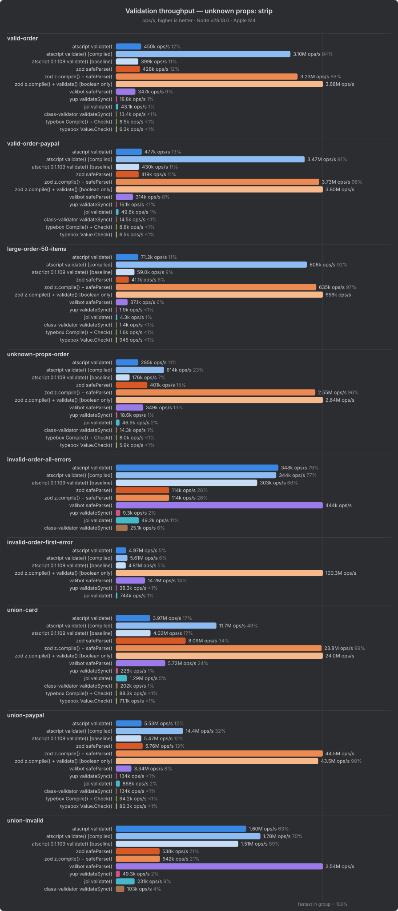
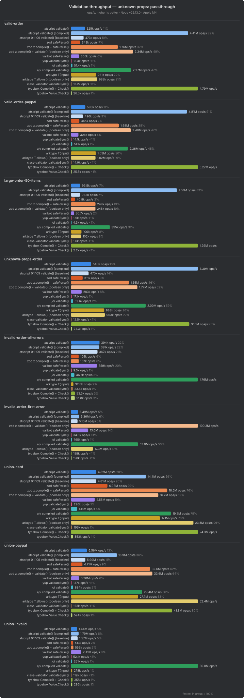
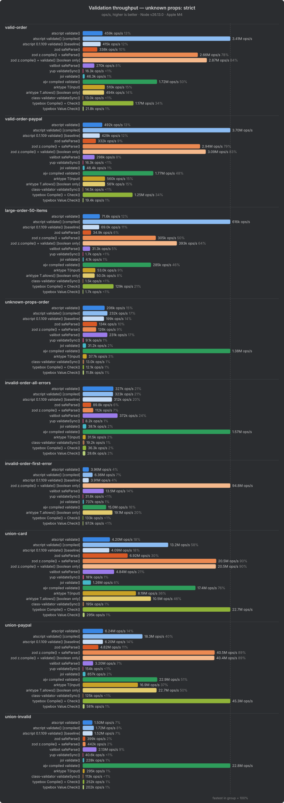

# Validator Benchmark Results

Throughput of validating the same `Order` model with an [atscript](https://atscript.dev) validator (interpreted, and compiled at build time) and the equivalent schema in 12 other engines of popular validation libraries. See [README.md](README.md) for what is measured and how the schemas were made equivalent.

- @atscript/typescript **0.2.1**, @atscript/core **0.2.1**, @atscript/typescript (via atscript-baseline) **0.1.109**, @atscript/core (via atscript-baseline) **0.1.109**, zod **4.6.7**, valibot **1.5.0**, yup **1.7.1**, joi **18.3.0**, ajv **8.20.0**, arktype **2.2.8**, class-validator **0.15.1**, class-transformer **0.5.1**, reflect-metadata **0.2.2**, typebox **1.4.2**
- 3 round(s) × 25 samples of ~40 ms per job, 1000 ms warmup, one child process per job; total 39 min
- Pre-flight: 2916 equivalence checks passed (every benchmark job, 57 edge cases × every engine × every mode it supports, unknown-props output, same-violation and first-error checks)
- Generated: 2026-11-03T13:22:31.930Z
- Chart data: [results/summary.json](results/summary.json) (`results[mode][scenario][engine]` = median ops/s)

Values are the **median ops/s** over all samples; the bracket is the p25–p75 range. "Relative" is versus the fastest engine in the same row group.

## Engines

| Engine | Call | Setup | Returns |
| --- | --- | --- | --- |
| atscript validate() | `validator.validate(input, true)` | `new Validator(type, { unknownProps, errorLimit })` | boolean (+ `validator.errors`); validates in place, no copy |
| atscript validate() [compiled] | `validator.validate(input, true)` | same as above, on the model built with `tsPlugin({ compileValidators: true })`: checks compiled at build time by the atscript plugin, no `new Function`/`eval` at runtime | same as above |
| atscript 0.1.109 validate() [baseline] | same as above | same as `atscript validate()`, on atscript 0.1.109 — the last release before compiled validators (the `atscript-baseline` workspace package) | same as above |
| zod safeParse() | `schema.safeParse(input)` | object JIT on (default) | `{ success, data \| error }`; `data` is a new object |
| zod z.compile() + safeParse() | `z.compile(schema).safeParse(input)` | `z.compile(schema, { strict: true })` | same as above, ahead-of-time compiled fast path |
| zod z.compile() + validate() [boolean only] | `z.compile(schema).validate(input)` | `z.compile(schema, { strict: true })` | boolean only, no output object, no error details |
| valibot safeParse() | `v.safeParser(schema, config)(input)` | `abortEarly: true` for first-error, all issues otherwise | `{ success, output \| issues }`; `output` is a new object |
| yup validateSync() | `schema.validateSync(input, options)` | `abortEarly: false` for all errors (`true` for first-error), leaves `.strict()` | the cast value (a new object only when something changed); throws `ValidationError` |
| joi validate() | `schema.prefs(options).validate(input)` | `abortEarly: false` for all errors (`true` for first-error), `convert: false` | `{ value, error }`; `value` is always a new object |
| ajv compiled validate() | `ajv.compile(jsonSchema)(input)` | `allErrors: true` for all errors (default `false` for first-error), `unicodeRegExp: false` | boolean (+ `validate.errors`); validates in place, no copy |
| arktype T(input) | `T(input)` | JIT (default) | the data, or an `ArkErrors` array |
| arktype T.allows() [boolean only] | `T.allows(input)` | JIT (default) | boolean only, no error details |
| class-validator validateSync() | `validateSync(plainToInstance(Order, input), options)` | decorated classes, class-transformer `plainToInstance` | `ValidationError[]`; the instance is a new object |
| typebox Compile() + Check() | `C.Check(input)`, then `C.Errors(input)` when invalid (first-error: `C.Parse(input)`) | `Compile(type)` (JIT); `maxErrors: Infinity`; first-error via `C.Parse()` | boolean; errors array from `Errors()`; validates (and cleans) in place |
| typebox Value.Check() | `Value.Check(T, input)`, then `Value.Errors(T, input)` when invalid | dynamic (no compile); `maxErrors: Infinity`; first-error via `Value.Parse()` | same as above, without compiling |

## Unknown props: strip

atscript `unknownProps: 'strip'` · zod `z.object()` · valibot `v.object()` · yup `stripUnknown: true` · joi `stripUnknown: true` · ajv `additionalProperties: false + removeAdditional: true` · arktype `'+': 'delete'` · class-validator `whitelist: true` · typebox `open objects + Clean() after Check()`

| Scenario | Engine | ops/s (median) | p25–p75 | ns/op | Relative |
| --- | --- | ---: | ---: | ---: | ---: |
| valid-order | zod z.compile() + validate() [boolean only] | 3,678,727 | 3,143,761–3,809,923 | 272 | fastest |
|  | zod z.compile() + safeParse() | 3,230,818 | 2,731,285–3,464,940 | 310 | 1.14x slower |
|  | atscript validate() [compiled] | 3,102,958 | 2,906,093–3,229,061 | 322 | 1.19x slower |
|  | atscript validate() | 450,444 | 435,384–455,707 | 2,220 | 8.17x slower |
|  | zod safeParse() | 427,804 | 296,997–449,783 | 2,338 | 8.60x slower |
|  | atscript 0.1.109 validate() [baseline] | 399,163 | 384,310–413,634 | 2,505 | 9.22x slower |
|  | valibot safeParse() | 347,123 | 332,145–353,055 | 2,881 | 10.60x slower |
|  | joi validate() | 43,133 | 41,817–48,017 | 23,184 | 85.29x slower |
|  | yup validateSync() | 18,812 | 16,763–19,275 | 53,157 | 195.55x slower |
|  | class-validator validateSync() | 13,375 | 12,531–15,048 | 74,768 | 275.05x slower |
|  | typebox Compile() + Check() | 8,518 | 7,656–8,796 | 117,392 | 431.88x slower |
|  | typebox Value.Check() | 6,345 | 5,915–6,652 | 157,605 | 579.78x slower |
| valid-order-paypal | zod z.compile() + validate() [boolean only] | 3,802,943 | 3,449,340–4,240,391 | 263 | fastest |
|  | zod z.compile() + safeParse() | 3,734,500 | 3,012,716–3,830,086 | 268 | 1.02x slower |
|  | atscript validate() [compiled] | 3,469,362 | 3,137,309–3,523,110 | 288 | 1.10x slower |
|  | atscript validate() | 476,644 | 460,194–490,527 | 2,098 | 7.98x slower |
|  | atscript 0.1.109 validate() [baseline] | 429,536 | 424,978–433,617 | 2,328 | 8.85x slower |
|  | zod safeParse() | 418,927 | 264,750–438,882 | 2,387 | 9.08x slower |
|  | valibot safeParse() | 314,379 | 299,082–343,420 | 3,181 | 12.10x slower |
|  | joi validate() | 49,822 | 49,060–50,688 | 20,072 | 76.33x slower |
|  | yup validateSync() | 16,118 | 14,205–16,742 | 62,043 | 235.94x slower |
|  | class-validator validateSync() | 14,480 | 13,414–14,953 | 69,061 | 262.63x slower |
|  | typebox Compile() + Check() | 8,813 | 8,394–9,007 | 113,466 | 431.52x slower |
|  | typebox Value.Check() | 6,483 | 6,061–6,750 | 154,251 | 586.60x slower |
| large-order-50-items | zod z.compile() + validate() [boolean only] | 656,045 | 521,233–669,417 | 1,524 | fastest |
|  | zod z.compile() + safeParse() | 635,282 | 487,126–649,190 | 1,574 | 1.03x slower |
|  | atscript validate() [compiled] | 605,623 | 588,488–623,347 | 1,651 | 1.08x slower |
|  | atscript validate() | 71,198 | 68,571–72,575 | 14,045 | 9.21x slower |
|  | atscript 0.1.109 validate() [baseline] | 58,968 | 53,631–66,070 | 16,958 | 11.13x slower |
|  | zod safeParse() | 41,115 | 37,715–44,090 | 24,322 | 15.96x slower |
|  | valibot safeParse() | 37,083 | 36,152–37,580 | 26,966 | 17.69x slower |
|  | joi validate() | 4,276 | 4,121–4,325 | 233,864 | 153.42x slower |
|  | yup validateSync() | 1,949 | 1,909–1,991 | 513,038 | 336.61x slower |
|  | typebox Compile() + Check() | 1,592 | 1,467–1,651 | 628,094 | 412.09x slower |
|  | class-validator validateSync() | 1,358 | 1,270–1,658 | 736,206 | 483.10x slower |
|  | typebox Value.Check() | 945 | 859–979 | 1,057,702 | 694.23x slower |
| unknown-props-order | zod z.compile() + validate() [boolean only] | 2,641,076 | 2,253,610–2,781,056 | 379 | fastest |
|  | zod z.compile() + safeParse() | 2,545,924 | 2,063,828–2,665,863 | 393 | 1.04x slower |
|  | atscript validate() [compiled] | 614,109 | 591,548–646,467 | 1,628 | 4.30x slower |
|  | zod safeParse() | 401,378 | 281,948–422,436 | 2,491 | 6.58x slower |
|  | valibot safeParse() | 349,378 | 331,943–360,844 | 2,862 | 7.56x slower |
|  | atscript validate() | 285,375 | 278,174–288,396 | 3,504 | 9.25x slower |
|  | atscript 0.1.109 validate() [baseline] | 175,530 | 161,054–179,021 | 5,697 | 15.05x slower |
|  | joi validate() | 46,875 | 44,368–48,844 | 21,333 | 56.34x slower |
|  | yup validateSync() | 18,570 | 16,456–19,355 | 53,852 | 142.22x slower |
|  | class-validator validateSync() | 14,299 | 13,479–14,630 | 69,933 | 184.70x slower |
|  | typebox Compile() + Check() | 8,005 | 7,512–8,511 | 124,925 | 329.93x slower |
|  | typebox Value.Check() | 5,941 | 5,598–6,329 | 168,313 | 444.55x slower |
| invalid-order-all-errors | valibot safeParse() | 443,815 | 404,879–446,790 | 2,253 | fastest |
|  | atscript validate() | 348,475 | 331,184–352,786 | 2,870 | 1.27x slower |
|  | atscript validate() [compiled] | 343,918 | 332,725–358,040 | 2,908 | 1.29x slower |
|  | atscript 0.1.109 validate() [baseline] | 303,148 | 282,086–339,079 | 3,299 | 1.46x slower |
|  | zod safeParse() | 114,276 | 91,424–133,315 | 8,751 | 3.88x slower |
|  | zod z.compile() + safeParse() | 114,212 | 104,266–138,117 | 8,756 | 3.89x slower |
|  | joi validate() | 49,216 | 47,683–50,697 | 20,319 | 9.02x slower |
|  | class-validator validateSync() | 25,148 | 23,623–26,023 | 39,765 | 17.65x slower |
|  | yup validateSync() | 9,324 | 9,086–9,449 | 107,251 | 47.60x slower |
| invalid-order-first-error | zod z.compile() + validate() [boolean only] | 100,328,402 | 76,425,195–101,416,760 | 10 | fastest |
|  | valibot safeParse() | 14,175,908 | 13,147,137–14,837,619 | 71 | 7.08x slower |
|  | atscript validate() [compiled] | 5,611,020 | 5,309,076–5,816,961 | 178 | 17.88x slower |
|  | atscript validate() | 4,965,011 | 4,878,938–5,258,265 | 201 | 20.21x slower |
|  | atscript 0.1.109 validate() [baseline] | 4,808,721 | 4,728,981–4,897,970 | 208 | 20.86x slower |
|  | joi validate() | 744,055 | 722,027–770,772 | 1,344 | 134.84x slower |
|  | yup validateSync() | 38,312 | 32,751–38,810 | 26,101 | 2618.72x slower |
| union-card | zod z.compile() + validate() [boolean only] | 23,983,877 | 22,612,513–24,203,277 | 42 | fastest |
|  | zod z.compile() + safeParse() | 23,845,672 | 22,031,742–24,418,996 | 42 | 1.01x slower |
|  | atscript validate() [compiled] | 11,653,170 | 11,508,308–11,705,626 | 86 | 2.06x slower |
|  | zod safeParse() | 8,086,985 | 7,976,550–8,173,382 | 124 | 2.97x slower |
|  | valibot safeParse() | 5,720,948 | 5,518,507–5,772,203 | 175 | 4.19x slower |
|  | atscript 0.1.109 validate() [baseline] | 4,018,550 | 3,949,607–4,054,579 | 249 | 5.97x slower |
|  | atscript validate() | 3,965,303 | 3,690,107–3,992,086 | 252 | 6.05x slower |
|  | joi validate() | 1,286,141 | 1,153,769–1,295,247 | 778 | 18.65x slower |
|  | yup validateSync() | 225,704 | 211,705–239,204 | 4,431 | 106.26x slower |
|  | class-validator validateSync() | 201,752 | 197,356–204,526 | 4,957 | 118.88x slower |
|  | typebox Compile() + Check() | 88,311 | 80,202–90,439 | 11,324 | 271.58x slower |
|  | typebox Value.Check() | 71,112 | 69,145–72,635 | 14,062 | 337.27x slower |
| union-paypal | zod z.compile() + safeParse() | 44,473,590 | 40,124,817–45,421,398 | 22 | fastest |
|  | zod z.compile() + validate() [boolean only] | 43,479,868 | 39,555,768–44,311,821 | 23 | 1.02x slower |
|  | atscript validate() [compiled] | 14,405,059 | 11,706,427–14,803,275 | 69 | 3.09x slower |
|  | zod safeParse() | 5,755,480 | 5,207,280–5,956,846 | 174 | 7.73x slower |
|  | atscript validate() | 5,529,006 | 5,400,346–5,589,873 | 181 | 8.04x slower |
|  | atscript 0.1.109 validate() [baseline] | 5,474,782 | 5,277,949–5,601,543 | 183 | 8.12x slower |
|  | valibot safeParse() | 3,342,303 | 3,118,251–3,712,534 | 299 | 13.31x slower |
|  | joi validate() | 868,356 | 836,805–882,416 | 1,152 | 51.22x slower |
|  | class-validator validateSync() | 134,306 | 121,924–144,046 | 7,446 | 331.14x slower |
|  | yup validateSync() | 133,898 | 123,951–139,836 | 7,468 | 332.15x slower |
|  | typebox Compile() + Check() | 94,187 | 89,763–99,444 | 10,617 | 472.18x slower |
|  | typebox Value.Check() | 86,287 | 77,051–87,802 | 11,589 | 515.41x slower |
| union-invalid | valibot safeParse() | 2,544,932 | 2,409,172–2,654,433 | 393 | fastest |
|  | atscript validate() [compiled] | 1,777,620 | 1,625,491–1,859,015 | 563 | 1.43x slower |
|  | atscript validate() | 1,602,324 | 1,560,621–1,612,468 | 624 | 1.59x slower |
|  | atscript 0.1.109 validate() [baseline] | 1,505,309 | 1,375,076–1,654,002 | 664 | 1.69x slower |
|  | zod z.compile() + safeParse() | 541,839 | 490,985–580,512 | 1,846 | 4.70x slower |
|  | zod safeParse() | 538,390 | 455,746–599,164 | 1,857 | 4.73x slower |
|  | joi validate() | 230,686 | 219,992–248,572 | 4,335 | 11.03x slower |
|  | class-validator validateSync() | 103,292 | 92,925–111,349 | 9,681 | 24.64x slower |
|  | yup validateSync() | 49,285 | 44,181–54,690 | 20,290 | 51.64x slower |

## Unknown props: passthrough

atscript `unknownProps: 'ignore'` · zod `z.looseObject()` · valibot `v.looseObject()` · yup `default` · joi `allowUnknown: true` · ajv `open objects` · arktype `'+': 'ignore' (default)` · class-validator `default` · typebox `open objects (default)`

| Scenario | Engine | ops/s (median) | p25–p75 | ns/op | Relative |
| --- | --- | ---: | ---: | ---: | ---: |
| valid-order | typebox Compile() + Check() | 4,785,558 | 4,698,010–4,834,197 | 209 | fastest |
|  | atscript validate() [compiled] | 4,413,564 | 3,672,232–4,507,407 | 227 | 1.08x slower |
|  | zod z.compile() + validate() [boolean only] | 2,336,689 | 2,076,368–2,514,804 | 428 | 2.05x slower |
|  | ajv compiled validate() | 2,265,284 | 2,214,357–2,331,040 | 441 | 2.11x slower |
|  | zod z.compile() + safeParse() | 1,762,421 | 1,551,998–1,875,026 | 567 | 2.72x slower |
|  | arktype T.allows() [boolean only] | 988,423 | 941,421–1,015,873 | 1,012 | 4.84x slower |
|  | arktype T(input) | 941,412 | 916,310–958,172 | 1,062 | 5.08x slower |
|  | atscript validate() | 525,176 | 489,063–555,525 | 1,904 | 9.11x slower |
|  | atscript 0.1.109 validate() [baseline] | 473,359 | 452,348–478,526 | 2,113 | 10.11x slower |
|  | zod safeParse() | 342,399 | 279,292–380,142 | 2,921 | 13.98x slower |
|  | valibot safeParse() | 304,530 | 290,824–315,052 | 3,284 | 15.71x slower |
|  | joi validate() | 51,374 | 43,145–52,283 | 19,465 | 93.15x slower |
|  | typebox Value.Check() | 26,460 | 24,804–27,205 | 37,792 | 180.86x slower |
|  | yup validateSync() | 18,416 | 16,104–19,348 | 54,300 | 259.86x slower |
|  | class-validator validateSync() | 16,245 | 14,058–16,738 | 61,556 | 294.59x slower |
| valid-order-paypal | typebox Compile() + Check() | 5,267,483 | 5,191,632–5,320,754 | 190 | fastest |
|  | atscript validate() [compiled] | 4,811,428 | 4,778,192–4,884,256 | 208 | 1.09x slower |
|  | zod z.compile() + validate() [boolean only] | 2,480,077 | 2,259,712–2,737,019 | 403 | 2.12x slower |
|  | ajv compiled validate() | 2,360,585 | 2,314,598–2,454,301 | 424 | 2.23x slower |
|  | zod z.compile() + safeParse() | 1,984,438 | 1,706,766–2,208,736 | 504 | 2.65x slower |
|  | arktype T(input) | 1,030,910 | 1,013,393–1,084,631 | 970 | 5.11x slower |
|  | arktype T.allows() [boolean only] | 1,016,911 | 967,310–1,032,894 | 983 | 5.18x slower |
|  | atscript validate() | 592,810 | 586,259–595,249 | 1,687 | 8.89x slower |
|  | atscript 0.1.109 validate() [baseline] | 495,782 | 485,243–503,540 | 2,017 | 10.62x slower |
|  | zod safeParse() | 345,284 | 222,701–364,887 | 2,896 | 15.26x slower |
|  | valibot safeParse() | 307,788 | 289,142–312,280 | 3,249 | 17.11x slower |
|  | joi validate() | 51,105 | 50,565–51,488 | 19,568 | 103.07x slower |
|  | typebox Value.Check() | 25,802 | 25,525–27,505 | 38,756 | 204.15x slower |
|  | class-validator validateSync() | 14,918 | 13,589–15,623 | 67,035 | 353.10x slower |
|  | yup validateSync() | 14,142 | 12,876–15,507 | 70,712 | 372.47x slower |
| large-order-50-items | typebox Compile() + Check() | 1,291,540 | 1,281,182–1,300,037 | 774 | fastest |
|  | atscript validate() [compiled] | 1,077,703 | 1,068,172–1,083,762 | 928 | 1.20x slower |
|  | ajv compiled validate() | 394,874 | 382,433–407,591 | 2,532 | 3.27x slower |
|  | zod z.compile() + safeParse() | 248,967 | 200,405–261,385 | 4,017 | 5.19x slower |
|  | zod z.compile() + validate() [boolean only] | 248,300 | 215,868–262,430 | 4,027 | 5.20x slower |
|  | arktype T(input) | 106,248 | 101,438–109,872 | 9,412 | 12.16x slower |
|  | arktype T.allows() [boolean only] | 102,321 | 90,638–107,426 | 9,773 | 12.62x slower |
|  | atscript validate() | 93,516 | 92,190–95,272 | 10,693 | 13.81x slower |
|  | atscript 0.1.109 validate() [baseline] | 91,339 | 82,616–94,323 | 10,948 | 14.14x slower |
|  | zod safeParse() | 40,784 | 35,954–42,605 | 24,519 | 31.67x slower |
|  | valibot safeParse() | 30,729 | 29,045–32,400 | 32,543 | 42.03x slower |
|  | joi validate() | 4,319 | 4,253–4,360 | 231,515 | 299.04x slower |
|  | typebox Value.Check() | 2,160 | 2,111–2,169 | 462,899 | 597.94x slower |
|  | yup validateSync() | 1,915 | 1,578–1,957 | 522,150 | 674.43x slower |
|  | class-validator validateSync() | 1,625 | 1,512–1,697 | 615,415 | 794.79x slower |
| unknown-props-order | atscript validate() [compiled] | 3,393,344 | 3,172,937–3,600,030 | 295 | fastest |
|  | typebox Compile() + Check() | 3,163,810 | 3,052,989–3,255,991 | 316 | 1.07x slower |
|  | ajv compiled validate() | 1,995,851 | 1,907,001–2,071,220 | 501 | 1.70x slower |
|  | zod z.compile() + validate() [boolean only] | 1,774,447 | 1,505,211–1,882,691 | 564 | 1.91x slower |
|  | zod z.compile() + safeParse() | 1,548,537 | 1,217,004–1,637,622 | 646 | 2.19x slower |
|  | arktype T.allows() [boolean only] | 903,155 | 762,016–956,844 | 1,107 | 3.76x slower |
|  | arktype T(input) | 887,570 | 834,418–914,291 | 1,127 | 3.82x slower |
|  | atscript validate() | 539,519 | 527,760–550,685 | 1,854 | 6.29x slower |
|  | atscript 0.1.109 validate() [baseline] | 470,177 | 432,146–476,252 | 2,127 | 7.22x slower |
|  | zod safeParse() | 311,406 | 267,641–347,315 | 3,211 | 10.90x slower |
|  | valibot safeParse() | 283,183 | 265,282–302,226 | 3,531 | 11.98x slower |
|  | joi validate() | 52,646 | 49,820–53,634 | 18,995 | 64.46x slower |
|  | typebox Value.Check() | 24,258 | 23,112–25,517 | 41,223 | 139.89x slower |
|  | yup validateSync() | 17,054 | 15,680–18,873 | 58,637 | 198.98x slower |
|  | class-validator validateSync() | 12,490 | 12,131–15,834 | 80,063 | 271.68x slower |
| invalid-order-all-errors | ajv compiled validate() | 1,757,491 | 1,652,809–1,873,499 | 569 | fastest |
|  | atscript validate() | 394,192 | 378,452–404,700 | 2,537 | 4.46x slower |
|  | atscript validate() [compiled] | 390,698 | 315,207–400,096 | 2,560 | 4.50x slower |
|  | atscript 0.1.109 validate() [baseline] | 366,969 | 364,487–368,489 | 2,725 | 4.79x slower |
|  | valibot safeParse() | 358,588 | 330,775–399,680 | 2,789 | 4.90x slower |
|  | zod z.compile() + safeParse() | 106,842 | 92,079–122,998 | 9,360 | 16.45x slower |
|  | zod safeParse() | 105,405 | 90,111–129,731 | 9,487 | 16.67x slower |
|  | typebox Compile() + Check() | 53,344 | 51,655–54,256 | 18,746 | 32.95x slower |
|  | typebox Value.Check() | 51,824 | 50,348–52,180 | 19,296 | 33.91x slower |
|  | joi validate() | 46,670 | 42,154–48,796 | 21,427 | 37.66x slower |
|  | arktype T(input) | 32,826 | 26,605–33,302 | 30,464 | 53.54x slower |
|  | class-validator validateSync() | 23,752 | 22,107–25,270 | 42,101 | 73.99x slower |
|  | yup validateSync() | 9,311 | 8,824–9,418 | 107,399 | 188.75x slower |
| invalid-order-first-error | zod z.compile() + validate() [boolean only] | 100,290,756 | 97,296,863–101,146,859 | 10 | fastest |
|  | ajv compiled validate() | 52,973,520 | 51,775,203–53,392,988 | 19 | 1.89x slower |
|  | arktype T.allows() [boolean only] | 17,299,659 | 16,417,831–20,207,313 | 58 | 5.80x slower |
|  | valibot safeParse() | 13,572,831 | 12,119,717–14,369,368 | 74 | 7.39x slower |
|  | atscript validate() [compiled] | 6,357,529 | 6,181,150–6,489,839 | 157 | 15.78x slower |
|  | atscript validate() | 5,493,080 | 5,404,067–5,555,331 | 182 | 18.26x slower |
|  | atscript 0.1.109 validate() [baseline] | 5,150,801 | 5,037,839–5,248,983 | 194 | 19.47x slower |
|  | joi validate() | 764,878 | 746,265–775,059 | 1,307 | 131.12x slower |
|  | typebox Value.Check() | 158,441 | 122,990–164,067 | 6,311 | 632.98x slower |
|  | typebox Compile() + Check() | 157,752 | 117,916–179,221 | 6,339 | 635.75x slower |
|  | yup validateSync() | 33,987 | 29,753–38,507 | 29,423 | 2950.86x slower |
| union-card | typebox Compile() + Check() | 24,340,658 | 23,283,962–24,912,658 | 41 | fastest |
|  | arktype T.allows() [boolean only] | 23,482,408 | 22,640,646–24,011,060 | 43 | 1.04x slower |
|  | ajv compiled validate() | 19,180,530 | 18,562,510–19,570,135 | 52 | 1.27x slower |
|  | zod z.compile() + safeParse() | 18,450,437 | 11,777,380–18,591,244 | 54 | 1.32x slower |
|  | arktype T(input) | 17,061,730 | 16,392,045–17,778,638 | 59 | 1.43x slower |
|  | zod z.compile() + validate() [boolean only] | 16,748,235 | 13,081,228–17,369,038 | 60 | 1.45x slower |
|  | atscript validate() [compiled] | 14,366,789 | 8,667,623–14,865,697 | 70 | 1.69x slower |
|  | zod safeParse() | 6,982,560 | 4,648,775–7,116,265 | 143 | 3.49x slower |
|  | atscript validate() | 4,824,394 | 3,838,360–4,859,858 | 207 | 5.05x slower |
|  | atscript 0.1.109 validate() [baseline] | 4,814,060 | 3,308,757–4,868,277 | 208 | 5.06x slower |
|  | valibot safeParse() | 4,552,126 | 4,211,364–4,893,182 | 220 | 5.35x slower |
|  | joi validate() | 1,175,591 | 1,112,576–1,245,621 | 851 | 20.71x slower |
|  | typebox Value.Check() | 352,771 | 299,068–374,893 | 2,835 | 69.00x slower |
|  | yup validateSync() | 219,731 | 212,867–228,014 | 4,551 | 110.77x slower |
|  | class-validator validateSync() | 195,544 | 179,735–204,720 | 5,114 | 124.48x slower |
| union-paypal | arktype T.allows() [boolean only] | 52,424,028 | 45,379,867–54,638,695 | 19 | fastest |
|  | typebox Compile() + Check() | 41,781,872 | 40,044,190–51,957,430 | 24 | 1.25x slower |
|  | zod z.compile() + validate() [boolean only] | 33,594,823 | 29,692,689–37,259,503 | 30 | 1.56x slower |
|  | zod z.compile() + safeParse() | 32,644,103 | 31,184,961–37,384,752 | 31 | 1.61x slower |
|  | ajv compiled validate() | 29,428,386 | 26,221,434–29,861,012 | 34 | 1.78x slower |
|  | arktype T(input) | 27,715,864 | 25,946,187–29,858,560 | 36 | 1.89x slower |
|  | atscript validate() [compiled] | 18,908,310 | 17,743,570–20,035,816 | 53 | 2.77x slower |
|  | atscript validate() | 6,561,718 | 5,479,085–6,764,446 | 152 | 7.99x slower |
|  | atscript 0.1.109 validate() [baseline] | 5,904,264 | 5,396,983–6,692,879 | 169 | 8.88x slower |
|  | zod safeParse() | 4,711,330 | 4,318,000–5,258,321 | 212 | 11.13x slower |
|  | valibot safeParse() | 3,363,302 | 2,970,529–3,713,749 | 297 | 15.59x slower |
|  | joi validate() | 883,948 | 783,656–927,633 | 1,131 | 59.31x slower |
|  | typebox Value.Check() | 524,433 | 474,937–674,043 | 1,907 | 99.96x slower |
|  | yup validateSync() | 137,040 | 123,626–141,327 | 7,297 | 382.55x slower |
|  | class-validator validateSync() | 122,853 | 108,967–140,717 | 8,140 | 426.72x slower |
| union-invalid | ajv compiled validate() | 30,004,128 | 24,597,913–31,541,139 | 33 | fastest |
|  | valibot safeParse() | 2,409,340 | 2,234,124–2,565,387 | 415 | 12.45x slower |
|  | atscript validate() [compiled] | 1,785,946 | 1,452,837–1,971,554 | 560 | 16.80x slower |
|  | atscript 0.1.109 validate() [baseline] | 1,565,487 | 1,462,381–1,792,876 | 639 | 19.17x slower |
|  | atscript validate() | 1,441,255 | 1,246,965–1,666,120 | 694 | 20.82x slower |
|  | zod z.compile() + safeParse() | 555,736 | 489,648–587,947 | 1,799 | 53.99x slower |
|  | zod safeParse() | 513,312 | 474,346–573,723 | 1,948 | 58.45x slower |
|  | typebox Compile() + Check() | 358,384 | 340,270–380,872 | 2,790 | 83.72x slower |
|  | typebox Value.Check() | 286,029 | 266,208–298,610 | 3,496 | 104.90x slower |
|  | arktype T(input) | 278,042 | 259,350–299,917 | 3,597 | 107.91x slower |
|  | joi validate() | 261,288 | 245,800–279,210 | 3,827 | 114.83x slower |
|  | class-validator validateSync() | 112,147 | 103,751–131,851 | 8,917 | 267.54x slower |
|  | yup validateSync() | 52,112 | 47,710–54,313 | 19,190 | 575.76x slower |

## Unknown props: strict

atscript `unknownProps: 'error'` · zod `z.strictObject()` · valibot `v.strictObject()` · yup `.exact()` · joi `default` · ajv `additionalProperties: false` · arktype `'+': 'reject'` · class-validator `whitelist + forbidNonWhitelisted` · typebox `additionalProperties: false`

| Scenario | Engine | ops/s (median) | p25–p75 | ns/op | Relative |
| --- | --- | ---: | ---: | ---: | ---: |
| valid-order | atscript validate() [compiled] | 3,408,769 | 3,339,169–3,459,349 | 293 | fastest |
|  | zod z.compile() + validate() [boolean only] | 2,866,082 | 2,438,793–2,992,713 | 349 | 1.19x slower |
|  | zod z.compile() + safeParse() | 2,657,913 | 2,214,342–2,788,092 | 376 | 1.28x slower |
|  | ajv compiled validate() | 1,716,545 | 1,542,101–1,779,064 | 583 | 1.99x slower |
|  | typebox Compile() + Check() | 1,172,215 | 1,036,251–1,225,013 | 853 | 2.91x slower |
|  | arktype T(input) | 509,879 | 487,448–532,766 | 1,961 | 6.69x slower |
|  | arktype T.allows() [boolean only] | 493,643 | 424,405–521,841 | 2,026 | 6.91x slower |
|  | atscript validate() | 459,027 | 446,599–466,743 | 2,179 | 7.43x slower |
|  | atscript 0.1.109 validate() [baseline] | 415,486 | 402,323–425,565 | 2,407 | 8.20x slower |
|  | zod safeParse() | 337,987 | 261,507–369,733 | 2,959 | 10.09x slower |
|  | valibot safeParse() | 269,822 | 257,555–281,036 | 3,706 | 12.63x slower |
|  | joi validate() | 46,305 | 43,204–48,167 | 21,596 | 73.62x slower |
|  | typebox Value.Check() | 21,755 | 21,380–22,115 | 45,966 | 156.69x slower |
|  | yup validateSync() | 16,286 | 15,084–18,282 | 61,404 | 209.31x slower |
|  | class-validator validateSync() | 13,035 | 12,602–15,931 | 76,716 | 261.51x slower |
| valid-order-paypal | atscript validate() [compiled] | 3,701,686 | 3,643,524–3,738,757 | 270 | fastest |
|  | zod z.compile() + validate() [boolean only] | 3,085,868 | 2,585,601–3,129,136 | 324 | 1.20x slower |
|  | zod z.compile() + safeParse() | 2,942,500 | 2,352,382–3,010,740 | 340 | 1.26x slower |
|  | ajv compiled validate() | 1,770,415 | 1,601,890–1,841,073 | 565 | 2.09x slower |
|  | typebox Compile() + Check() | 1,251,106 | 1,176,298–1,283,560 | 799 | 2.96x slower |
|  | arktype T.allows() [boolean only] | 560,588 | 539,687–613,501 | 1,784 | 6.60x slower |
|  | arktype T(input) | 560,236 | 467,901–575,245 | 1,785 | 6.61x slower |
|  | atscript validate() | 491,753 | 485,087–497,281 | 2,034 | 7.53x slower |
|  | atscript 0.1.109 validate() [baseline] | 428,983 | 425,260–432,582 | 2,331 | 8.63x slower |
|  | zod safeParse() | 332,261 | 223,987–352,717 | 3,010 | 11.14x slower |
|  | valibot safeParse() | 298,001 | 287,219–305,701 | 3,356 | 12.42x slower |
|  | joi validate() | 48,412 | 46,067–49,630 | 20,656 | 76.46x slower |
|  | typebox Value.Check() | 19,377 | 18,370–21,408 | 51,607 | 191.04x slower |
|  | yup validateSync() | 16,339 | 14,648–16,824 | 61,203 | 226.56x slower |
|  | class-validator validateSync() | 14,482 | 14,000–15,186 | 69,052 | 255.61x slower |
| large-order-50-items | atscript validate() [compiled] | 616,211 | 558,318–619,220 | 1,623 | fastest |
|  | zod z.compile() + validate() [boolean only] | 393,066 | 325,703–407,754 | 2,544 | 1.57x slower |
|  | zod z.compile() + safeParse() | 305,250 | 292,837–393,194 | 3,276 | 2.02x slower |
|  | ajv compiled validate() | 285,133 | 271,896–295,467 | 3,507 | 2.16x slower |
|  | typebox Compile() + Check() | 128,751 | 112,216–136,032 | 7,767 | 4.79x slower |
|  | atscript validate() | 71,623 | 70,071–72,614 | 13,962 | 8.60x slower |
|  | atscript 0.1.109 validate() [baseline] | 69,036 | 50,807–71,371 | 14,485 | 8.93x slower |
|  | arktype T(input) | 52,952 | 45,006–56,089 | 18,885 | 11.64x slower |
|  | arktype T.allows() [boolean only] | 50,026 | 47,479–55,668 | 19,990 | 12.32x slower |
|  | zod safeParse() | 34,880 | 24,181–41,735 | 28,670 | 17.67x slower |
|  | valibot safeParse() | 31,271 | 29,692–33,055 | 31,979 | 19.71x slower |
|  | joi validate() | 4,132 | 3,125–4,322 | 242,019 | 149.13x slower |
|  | typebox Value.Check() | 1,721 | 1,124–1,753 | 581,186 | 358.05x slower |
|  | yup validateSync() | 1,696 | 1,328–1,885 | 589,740 | 363.33x slower |
|  | class-validator validateSync() | 1,488 | 1,080–1,624 | 672,193 | 414.12x slower |
| unknown-props-order | ajv compiled validate() | 1,382,902 | 1,310,272–1,487,724 | 723 | fastest |
|  | atscript validate() [compiled] | 231,935 | 199,067–236,670 | 4,312 | 5.96x slower |
|  | valibot safeParse() | 230,998 | 216,249–240,760 | 4,329 | 5.99x slower |
|  | atscript validate() | 205,771 | 200,097–217,415 | 4,860 | 6.72x slower |
|  | atscript 0.1.109 validate() [baseline] | 199,394 | 156,305–206,798 | 5,015 | 6.94x slower |
|  | zod safeParse() | 133,794 | 115,108–146,998 | 7,474 | 10.34x slower |
|  | zod z.compile() + safeParse() | 126,074 | 109,440–151,911 | 7,932 | 10.97x slower |
|  | arktype T(input) | 37,670 | 35,806–39,433 | 26,547 | 36.71x slower |
|  | joi validate() | 31,156 | 28,067–33,691 | 32,096 | 44.39x slower |
|  | class-validator validateSync() | 12,996 | 12,529–13,624 | 76,947 | 106.41x slower |
|  | typebox Compile() + Check() | 12,103 | 11,811–12,350 | 82,624 | 114.26x slower |
|  | typebox Value.Check() | 11,836 | 11,662–12,251 | 84,490 | 116.84x slower |
|  | yup validateSync() | 9,070 | 8,350–9,414 | 110,254 | 152.47x slower |
| invalid-order-all-errors | ajv compiled validate() | 1,572,572 | 1,135,058–1,598,549 | 636 | fastest |
|  | valibot safeParse() | 371,741 | 357,253–396,767 | 2,690 | 4.23x slower |
|  | atscript validate() | 326,924 | 317,582–333,720 | 3,059 | 4.81x slower |
|  | atscript validate() [compiled] | 323,021 | 304,871–334,635 | 3,096 | 4.87x slower |
|  | atscript 0.1.109 validate() [baseline] | 312,330 | 235,756–319,290 | 3,202 | 5.03x slower |
|  | zod z.compile() + safeParse() | 112,403 | 97,123–132,537 | 8,897 | 13.99x slower |
|  | zod safeParse() | 89,818 | 76,561–111,720 | 11,134 | 17.51x slower |
|  | joi validate() | 38,137 | 20,649–41,929 | 26,221 | 41.23x slower |
|  | typebox Compile() + Check() | 36,288 | 21,514–37,982 | 27,557 | 43.34x slower |
|  | arktype T(input) | 31,526 | 23,041–32,209 | 31,720 | 49.88x slower |
|  | typebox Value.Check() | 28,629 | 22,391–33,686 | 34,930 | 54.93x slower |
|  | class-validator validateSync() | 19,227 | 15,206–22,662 | 52,010 | 81.79x slower |
|  | yup validateSync() | 8,162 | 7,638–8,482 | 122,515 | 192.67x slower |
| invalid-order-first-error | zod z.compile() + validate() [boolean only] | 94,761,774 | 85,724,457–100,035,338 | 11 | fastest |
|  | arktype T.allows() [boolean only] | 19,088,735 | 18,179,638–19,452,448 | 52 | 4.96x slower |
|  | ajv compiled validate() | 15,047,906 | 14,928,364–15,389,109 | 66 | 6.30x slower |
|  | valibot safeParse() | 13,523,359 | 12,235,752–14,283,867 | 74 | 7.01x slower |
|  | atscript validate() [compiled] | 6,362,681 | 5,835,551–6,464,654 | 157 | 14.89x slower |
|  | atscript validate() | 3,964,455 | 2,964,793–4,201,343 | 252 | 23.90x slower |
|  | atscript 0.1.109 validate() [baseline] | 3,914,099 | 3,857,923–4,032,782 | 255 | 24.21x slower |
|  | joi validate() | 736,751 | 675,759–760,753 | 1,357 | 128.62x slower |
|  | typebox Compile() + Check() | 132,757 | 123,111–137,725 | 7,533 | 713.80x slower |
|  | typebox Value.Check() | 97,025 | 85,497–99,303 | 10,307 | 976.67x slower |
|  | yup validateSync() | 31,762 | 29,738–35,400 | 31,485 | 2983.50x slower |
| union-card | typebox Compile() + Check() | 22,719,133 | 20,968,836–23,164,708 | 44 | fastest |
|  | zod z.compile() + safeParse() | 20,548,176 | 16,507,227–22,021,245 | 49 | 1.11x slower |
|  | zod z.compile() + validate() [boolean only] | 20,488,544 | 16,518,539–21,793,204 | 49 | 1.11x slower |
|  | ajv compiled validate() | 17,354,322 | 15,847,585–18,298,997 | 58 | 1.31x slower |
|  | atscript validate() [compiled] | 13,155,240 | 12,045,916–14,015,696 | 76 | 1.73x slower |
|  | arktype T.allows() [boolean only] | 10,502,114 | 10,206,103–10,743,746 | 95 | 2.16x slower |
|  | arktype T(input) | 8,191,255 | 7,838,256–8,678,184 | 122 | 2.77x slower |
|  | zod safeParse() | 6,921,775 | 6,775,260–7,026,832 | 144 | 3.28x slower |
|  | valibot safeParse() | 4,836,073 | 4,412,974–5,099,824 | 207 | 4.70x slower |
|  | atscript validate() | 4,195,636 | 3,778,422–4,351,950 | 238 | 5.41x slower |
|  | atscript 0.1.109 validate() [baseline] | 4,094,993 | 3,928,624–4,268,921 | 244 | 5.55x slower |
|  | joi validate() | 1,264,801 | 1,217,060–1,289,296 | 791 | 17.96x slower |
|  | typebox Value.Check() | 295,263 | 266,977–300,830 | 3,387 | 76.95x slower |
|  | class-validator validateSync() | 194,760 | 186,482–200,397 | 5,135 | 116.65x slower |
|  | yup validateSync() | 181,036 | 162,515–201,445 | 5,524 | 125.50x slower |
| union-paypal | typebox Compile() + Check() | 45,275,218 | 44,160,048–46,023,493 | 22 | fastest |
|  | zod z.compile() + safeParse() | 40,471,304 | 39,863,224–40,931,446 | 25 | 1.12x slower |
|  | zod z.compile() + validate() [boolean only] | 40,378,117 | 39,053,572–41,066,901 | 25 | 1.12x slower |
|  | ajv compiled validate() | 22,870,597 | 21,215,944–23,227,401 | 44 | 1.98x slower |
|  | arktype T.allows() [boolean only] | 22,654,213 | 22,127,691–22,920,549 | 44 | 2.00x slower |
|  | atscript validate() [compiled] | 18,333,328 | 17,018,438–19,431,899 | 55 | 2.47x slower |
|  | arktype T(input) | 16,929,811 | 16,095,418–17,096,936 | 59 | 2.67x slower |
|  | atscript validate() | 6,242,748 | 6,190,993–6,340,518 | 160 | 7.25x slower |
|  | atscript 0.1.109 validate() [baseline] | 6,200,410 | 6,145,250–6,287,141 | 161 | 7.30x slower |
|  | zod safeParse() | 4,818,749 | 4,383,880–4,982,960 | 208 | 9.40x slower |
|  | valibot safeParse() | 3,197,322 | 2,968,945–3,277,348 | 313 | 14.16x slower |
|  | joi validate() | 857,252 | 817,385–872,739 | 1,167 | 52.81x slower |
|  | typebox Value.Check() | 581,055 | 566,505–588,659 | 1,721 | 77.92x slower |
|  | yup validateSync() | 153,618 | 146,391–161,494 | 6,510 | 294.73x slower |
|  | class-validator validateSync() | 124,759 | 117,669–129,241 | 8,015 | 362.90x slower |
| union-invalid | ajv compiled validate() | 22,769,149 | 22,006,669–23,286,185 | 44 | fastest |
|  | valibot safeParse() | 2,129,611 | 1,920,263–2,200,409 | 470 | 10.69x slower |
|  | atscript validate() [compiled] | 1,722,221 | 1,698,090–1,732,049 | 581 | 13.22x slower |
|  | atscript 0.1.109 validate() [baseline] | 1,518,658 | 1,439,779–1,560,122 | 658 | 14.99x slower |
|  | atscript validate() | 1,497,595 | 1,422,386–1,526,157 | 668 | 15.20x slower |
|  | zod z.compile() + safeParse() | 441,624 | 373,121–456,800 | 2,264 | 51.56x slower |
|  | zod safeParse() | 398,516 | 367,784–457,100 | 2,509 | 57.13x slower |
|  | arktype T(input) | 295,113 | 272,584–300,352 | 3,389 | 77.15x slower |
|  | typebox Compile() + Check() | 251,553 | 243,029–256,954 | 3,975 | 90.51x slower |
|  | joi validate() | 227,531 | 222,950–232,036 | 4,395 | 100.07x slower |
|  | typebox Value.Check() | 201,553 | 189,849–211,320 | 4,961 | 112.97x slower |
|  | class-validator validateSync() | 112,977 | 107,063–135,202 | 8,851 | 201.54x slower |
|  | yup validateSync() | 40,589 | 38,517–43,060 | 24,637 | 560.97x slower |

## Not run

Cells an engine skips, and why (see README for details):

| Engine | Reason | Cells |
| --- | --- | --- |
| ajv compiled validate() | strip: with `allErrors: true` (all-errors and valid cells), `removeAdditional` deletes keys while ajv tries the `anyOf` branches (the card branch strips the PayPal `email`) | strip: all |
| arktype T(input) | strip: ArkType rejects a union of objects that delete undeclared keys | strip: all |
| arktype T(input) | no stop-at-first-error option | passthrough: invalid-order-first-error; strict: invalid-order-first-error |
| arktype T.allows() [boolean only] | strip: ArkType rejects a union of objects that delete undeclared keys | strip: all |
| arktype T.allows() [boolean only] | boolean only: no error report to compare | passthrough: invalid-order-all-errors, union-invalid; strict: unknown-props-order, invalid-order-all-errors, union-invalid |
| zod z.compile() + validate() [boolean only] | boolean only: no error report to compare | strip: invalid-order-all-errors, union-invalid; passthrough: invalid-order-all-errors, union-invalid; strict: unknown-props-order, invalid-order-all-errors, union-invalid |
| typebox Compile() + Check() | identical to passthrough (Clean() runs only on valid input) | strip: invalid-order-all-errors, invalid-order-first-error, union-invalid |
| typebox Value.Check() | identical to passthrough (Clean() runs only on valid input) | strip: invalid-order-all-errors, invalid-order-first-error, union-invalid |
| zod safeParse() | no public stop-at-first-error option for safeParse | strip: invalid-order-first-error; passthrough: invalid-order-first-error; strict: invalid-order-first-error |
| zod z.compile() + safeParse() | no public stop-at-first-error option for safeParse | strip: invalid-order-first-error; passthrough: invalid-order-first-error; strict: invalid-order-first-error |
| class-validator validateSync() | `stopAtFirstError` stops per property only | strip: invalid-order-first-error; passthrough: invalid-order-first-error; strict: invalid-order-first-error |

## Notes

- Invalid-input scenarios: every engine runs with its library's default error reporting, and the pre-flight confirmed they all catch the same violations (same paths, and the failed `payment` union). Raw error counts differ by how each library reports a failed union and nested failures. Errors reported for `invalid-order-all-errors`:
  - strip: atscript 15, atscript-compiled 15, atscript-baseline 15, zod 18, zod-compiled 18, valibot 18, yup 15, joi 15, class-validator 16
  - passthrough: atscript 15, atscript-compiled 15, atscript-baseline 15, zod 18, zod-compiled 18, valibot 18, yup 15, joi 15, ajv 20, arktype 15, class-validator 16, typebox-compiled 22, typebox-value 22
  - strict: atscript 15, atscript-compiled 15, atscript-baseline 15, zod 18, zod-compiled 18, valibot 18, yup 16, joi 15, ajv 24, arktype 15, class-validator 20, typebox-compiled 27, typebox-value 27
- `invalid-order-first-error`: engines with a stop-at-first-error option run it and report exactly 1 error; boolean-only engines (zod z.compile() + validate() [boolean only], arktype T.allows() [boolean only]) return `false` at the first failure. Engines without such an option skip it.
- Boolean-only engines run only where a yes/no answer is comparable: valid inputs and the first-error scenario.
- `unknown-props-order` gets a freshly built input for every call (built outside the timed region) because some engines strip unknown keys from the input in place (atscript validate(), atscript validate() [compiled], atscript 0.1.109 validate() [baseline], typebox Compile() + Check(), typebox Value.Check()); all engines use the same fresh inputs in all modes.

## Environment

|  |  |
| --- | --- |
| Date | 2026-11-03T13:22:31.930Z |
| Node.js | v26.13.0 (V8 14.6.202.34-node.40) |
| OS | Darwin 27.0.0 (darwin arm64) |
| CPU | Apple M4 (10 logical cores) |
| Memory | 24 GB |

### Settings

| Setting | Value |
| --- | --- |
| Rounds | 3 (forward, reversed, then seeded shuffle; fresh process per job × round) |
| Warmup | 1000 ms per job (time-based; also calibrates batch size) |
| Samples | 25 per job per round, ~40 ms each (process.hrtime.bigint) |
| Reported value | median ops/s over all pooled samples; p25–p75 range |
| Node flags | --expose-gc (untimed gc() before every sample) |

### Package versions

| Package | Version |
| --- | --- |
| @atscript/typescript | 0.2.1 |
| @atscript/core | 0.2.1 |
| @atscript/typescript (via atscript-baseline) | 0.1.109 |
| @atscript/core (via atscript-baseline) | 0.1.109 |
| zod | 4.6.7 |
| valibot | 1.5.0 |
| yup | 1.7.1 |
| joi | 18.3.0 |
| ajv | 8.20.0 |
| arktype | 2.2.8 |
| class-validator | 0.15.1 |
| class-transformer | 0.5.1 |
| reflect-metadata | 0.2.2 |
| typebox | 1.4.2 |

