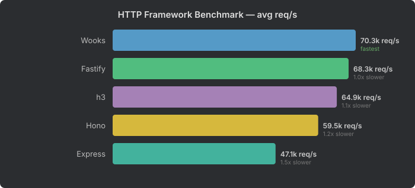
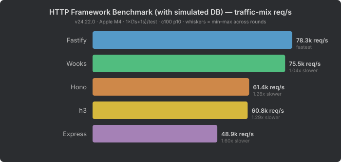

# HTTP Framework Benchmark

A benchmark comparing full HTTP request handling for Node.js frameworks, using a realistic enterprise SaaS API workload.

## Frameworks Tested

| Framework | Router | Description |
|-----------|--------|-------------|
| [Wooks](https://wooks.moost.org/) | @prostojs/router | Composable HTTP framework with lazy context |
| [Fastify](https://fastify.dev/) | find-my-way | Performance-focused framework with schema validation |
| [h3](https://h3.dev/) v2 | rou3 | Minimal web-standard HTTP framework, served via its own `serve()` (srvx) |
| [Hono](https://hono.dev/) | SmartRouter (RegExpRouter / TrieRouter) | Ultralight, multi-runtime framework, via `@hono/node-server` |
| [Express](https://expressjs.com/) | path-to-regexp | The original Node.js framework (baseline) |

## What This Measures

Unlike the [router benchmark](../router-benchmark/), which isolates pure route matching, this benchmark tests **the full request lifecycle**:

- HTTP parsing and routing
- Header inspection (Bearer token, cookies)
- Auth guard checks (reject before body parse)
- Cookie parsing (~20-cookie jar, typical for a SaaS browser session)
- JSON body parsing (small and large payloads)
- Response serialization with cache headers

Each framework implements the same 22-route project management API with identical behavior — same status codes, response bodies, `Cache-Control`/`Set-Cookie` headers, auth checks, cookie parsing and JSON body parsing + validation (non-object or malformed bodies → 400). An automated pre-flight check verifies this for every server before it is measured.

Each server is written the way a competent user of that framework would write it:

| Framework | Auth | Body parsing / validation |
|-----------|------|---------------------------|
| Wooks | composable called first in the handler | `useBody().parseBody()` after auth |
| Fastify | per-route `onRequest` hook (runs before the content-type parser) | built-in parser + JSON schema `{ type: 'object' }` |
| h3 | per-route middleware | `readBody()` in the handler |
| Hono | per-route middleware | built-in `validator('json')` after the auth middleware |
| Express | per-route middleware | `express.json()` placed after the auth middleware |

So every framework rejects unauthorized requests **without parsing the body**.

## Key Insight: Routing Doesn't Matter Much in Practice

The [router benchmark](../router-benchmark/) shows **up to 16x differences** between the fastest and slowest routers (ProstoRouter 38k vs Express 2k op/ms). But in this full framework benchmark, the gap compresses to just **1.5x** (Wooks 70k vs Express 47k req/s).

Why? Because routing is a tiny fraction of what a real HTTP server does. The rest — TCP handling, HTTP parsing, header inspection, cookie parsing, body deserialization, response building — dominates the total cost. A router that's 4x faster than another might save microseconds per request, but those microseconds are dwarfed by the milliseconds spent parsing a 20-cookie jar or deserializing a JSON body.

This is why **framework architecture matters more than raw router speed**.

## Results

See [RESULTS.md](RESULTS.md) for the latest results.



| Framework | avg req/s | speed |
|-----------|----------|-------|
| Wooks | 70,332 | fastest |
| Fastify | 68,273 | 1.0x slower |
| h3 | 64,860 | 1.1x slower |
| Hono | 59,466 | 1.2x slower |
| Express | 47,147 | 1.5x slower |

### Where Wooks Wins

**Cookie-auth reads (42% of traffic)** — the dominant workload in any SaaS app. Wooks handles cookie-authenticated GET requests at ~82k req/s, compared to Fastify's ~73k and h3/Hono's ~65k. This is where Wooks' lazy cookie parsing pays off — cookies are only parsed when accessed, not on every request.

**Early auth rejection** — when a request arrives with a large JSON body but invalid credentials, Wooks rejects it at ~34k req/s without ever parsing the body. Fastify and Express parse the body first and only then check auth, dropping to ~9k req/s. h3 also rejects early (~39k). This is 3–4x faster on attack traffic.

### Where Others Win

**Static routes and auth failures** — Fastify leads on simple GETs without cookies (~88k) and 404s (~86k), thanks to its highly optimized find-my-way trie and fast error handling.

**Body parsing** — h3 has the fastest JSON body parsing (~57–70k on small POSTs vs ~47–56k for Wooks/Fastify). This is likely due to h3's minimal overhead and direct body reading.

### What's Equal

**Large body parsing** — all frameworks converge at ~9–11k req/s for 100-item JSON payloads. At this point, `JSON.parse()` itself is the bottleneck, and no framework can optimize around it.

## With Simulated DB (Redis)

What happens when handlers do real work? In production, every authenticated request hits a database. We added a Redis GET/SET/DEL call to every authenticated handler to simulate this — each request makes a real network round-trip to a local Redis server.

See [RESULTS-DB.md](RESULTS-DB.md) for the full breakdown.



| Framework | avg req/s | speed |
|-----------|----------|-------|
| Wooks | 50,854 | fastest |
| Fastify | 49,879 | 1.0x slower |
| h3 | 47,575 | 1.1x slower |
| Hono | 45,542 | 1.1x slower |
| Express | 37,868 | 1.3x slower |

### The Gap Compresses

Without DB calls, the fastest-to-slowest gap is **1.5x** (Wooks 70k vs Express 47k). With a single Redis call per authenticated request, it compresses to **1.3x** (Wooks 51k vs Express 38k). The top four frameworks (Wooks, Fastify, h3, Hono) are now within **12%** of each other.

The more real server-side processing you add — database queries, cache lookups, business logic, external API calls — the more these framework differences compress. In a real application with multiple DB queries, template rendering, and I/O-bound work per request, the framework overhead becomes negligible. **Choose your framework for developer experience, not for benchmarks.**

## Methodology

- Every framework server runs in its **own child process** — plain `node <entry>` with identical flags for all frameworks (`NODE_ENV=production`, logging disabled, bound to 127.0.0.1) — started fresh for each round and killed afterwards — one server at a time.
- Handlers are synchronous in pure mode (no per-request Promise/microtask that is not the framework's own cost); only `--db` mode returns a promise for the Redis round-trip. Handlers that read the body themselves (Wooks, h3) stay `async`.
- The load generator ([autocannon](https://github.com/mcollina/autocannon), 100 connections, pipelining 10) runs in the orchestrator process, which does nothing else during a measurement.
- **Pre-flight equivalence check** on every server start: each test (plus two invalid-body checks) is sent once and status, body and relevant headers are compared with the expected values; any mismatch aborts the run.
- Per test: **2 s warmup** (discarded) + **5 s measured**; **3 rounds** with the framework order rotated; the per-test value is the **median** over rounds (min–max and CV are reported).
- **Drain between runs:** autocannon stops by destroying its sockets, possibly mid-request. After every run the orchestrator asks the server process (over its IPC channel, never during a measurement) to report once all client connections are closed; if any are still open after 5 s the run aborts.
- Any measured run with more than 0.1% unexpected status codes / socket errors is marked **INVALID** and flagged in the results.
- The headline number is the **traffic-mix throughput**: the weighted *harmonic* mean of the per-test medians using the traffic weights in the [root README](../../README.md#traffic-distribution) — i.e. the req/s of a server receiving that request mix. (A weighted arithmetic mean of rates would over-weight cheap requests; it is still shown for reference.)
- Results files record Node.js version, CPU, OS, the exact package versions and all run settings.

All settings are configurable: `--warmup <s> --duration <s> --rounds <n> --connections <n> --pipelining <n> --workers <n> --only wooks,fastify --quick` (or `BENCH_*` env vars; invalid values and unknown options are rejected). `--quick` is a smoke test (1 s per test, 1 round) — its numbers are not meaningful; smoke and `--only` runs are written to the git-ignored `.quick/` directory.

## Running

```bash
pnpm install
pnpm bench:wooks        # pure framework overhead (~40 min)
pnpm bench:wooks:db     # with simulated Redis DB calls (requires Redis on 127.0.0.1:6379; ~40 min)
pnpm --filter wooks-benchmark quick   # smoke test (~3 min, numbers not meaningful)
```
